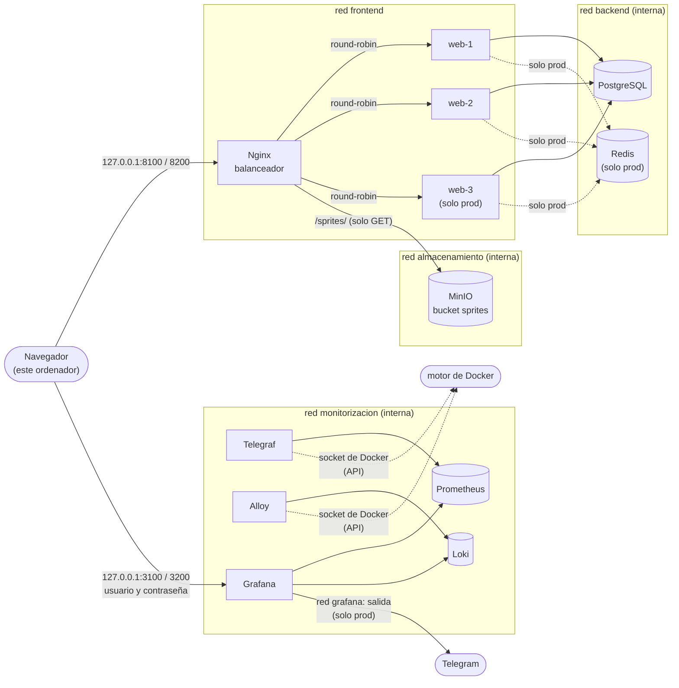
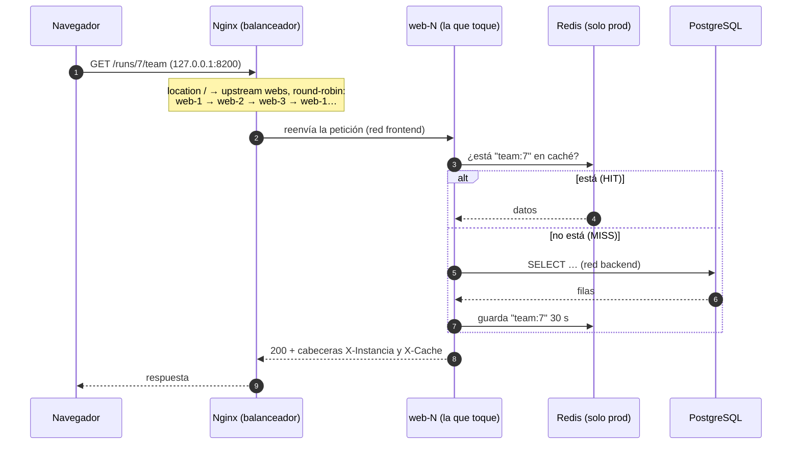
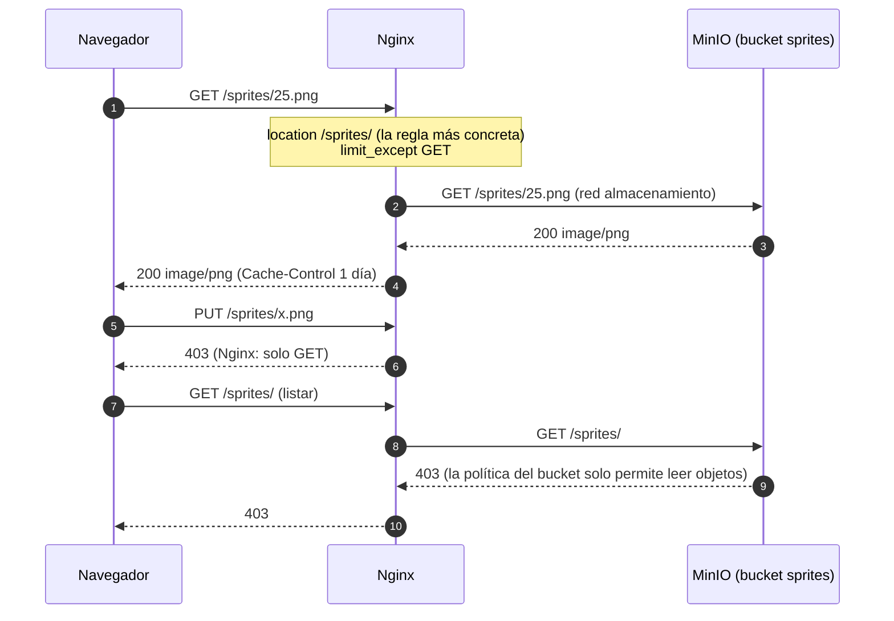
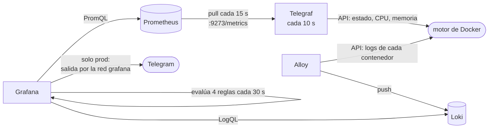
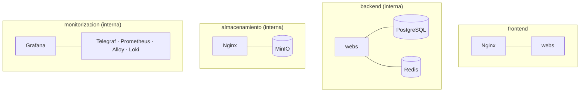
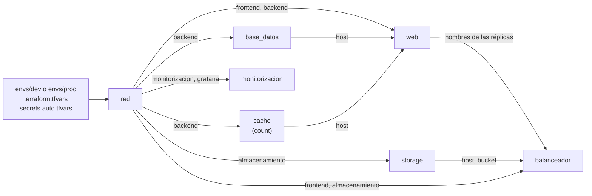
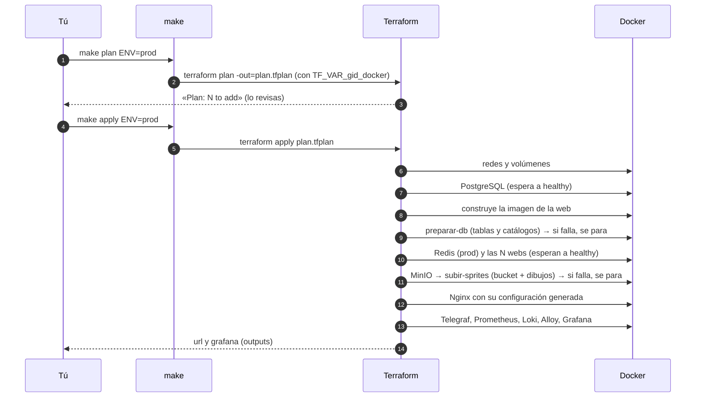

# Tracker Randomlocke · Infraestructura como código con Terraform

Práctica 2 de Redes Avanzadas (UIB). Despliega con **Terraform y el provider de Docker** la aplicación de la Práctica 1, el «Tracker Randomlocke» (FastAPI + PostgreSQL + Redis), simulando un despliegue en la nube. Se le añaden:

- un **balanceador de carga** con **alta disponibilidad**;
- **almacenamiento de objetos con MinIO**;
- **monitorización con logs centralizados y alertas a Telegram**;
- **dos entornos** (dev y prod) que pueden estar levantados a la vez.

Este README explica **cómo está montada la infraestructura, por qué así, cómo instalarla y cómo probarla**. La app se describe en lo justo para entender qué hace cada pieza.

## Índice

1. [Qué pide el enunciado y dónde está](#1-qué-pide-el-enunciado-y-dónde-está)
2. [La aplicación en un minuto](#2-la-aplicación-en-un-minuto)
3. [Arquitectura](#3-arquitectura)
4. [Cómo viaja cada petición](#4-cómo-viaja-cada-petición)
5. [Nginx por dentro](#5-nginx-por-dentro)
6. [Redes: quién puede hablar con quién](#6-redes-quién-puede-hablar-con-quién)
7. [Terraform: cómo está organizado y cómo funciona](#7-terraform-cómo-está-organizado-y-cómo-funciona)
8. [Instalación](#8-instalación)
9. [Uso diario (Makefile)](#9-uso-diario-makefile)
10. [Cómo cambiar cosas (y predecir el `plan`)](#10-cómo-cambiar-cosas-y-predecir-el-plan)
11. [Probar el proyecto](#11-probar-el-proyecto)
12. [Tests y sus salidas](#12-tests-y-sus-salidas)
13. [Monitorización, logs y alertas](#13-monitorización-logs-y-alertas)
14. [Seguridad](#14-seguridad)
15. [Mejoras respecto a la Práctica 1](#15-mejoras-respecto-a-la-práctica-1)
16. [Decisiones técnicas](#16-decisiones-técnicas)
17. [Limitaciones conocidas y mejoras futuras](#17-limitaciones-conocidas-y-mejoras-futuras)
18. [Problemas frecuentes](#18-problemas-frecuentes)
19. [Glosario](#19-glosario)
20. [Documentación del desarrollo](#20-documentación-del-desarrollo)

---

## 1. Qué pide el enunciado y dónde está

| Requisito | Cómo se cumple | Dónde |
|---|---|---|
| App web, BD y caché de la P1, en Terraform | FastAPI (imagen construida por Terraform), PostgreSQL 16 y Redis 7 | `modules/web`, `modules/base_datos`, `modules/cache` |
| Balanceador que reparte entre varias webs | **Nginx** con **round-robin** delante de las réplicas | `modules/balanceador` |
| Ver en la web en qué instancia has caído | Etiqueta «Instancia: tracker-prod-web-2» en la página, campo `instancia` en `/status` y cabecera `X-Instancia` | `app/main.py`, `app/static/` |
| dev: 2 webs; prod: al menos 3 | `replicas_web = 2` / `replicas_web = 3` | `envs/*/terraform.tfvars` |
| Caché en prod | `cache_activada = true` solo en prod | `envs/prod/terraform.tfvars` |
| Alta disponibilidad de las webs | Nginx aparta la web que falla y reintenta en otra; Docker reinicia los contenedores caídos | `nginx.conf.tftpl` (`max_fails`, `proxy_next_upstream`), `restart = "unless-stopped"` |
| Monitorizar el estado, la CPU y la memoria | Telegraf → Prometheus → Grafana, con panel creado desde el código | `modules/monitorizacion` |
| Logs centralizados consultables en la plataforma | Alloy → Loki → Grafana (panel y Explore) | `modules/monitorizacion` |
| prod con alertas que se puedan disparar en la demo | 4 reglas en Grafana; en prod se envían a **Telegram**. `make stop-web WEB=2 ENV=prod` dispara «Web caída» | `grafana-alertas.yml.tftpl`, `grafana-telegram.yml.tftpl` |
| Estáticos en MinIO (S3 simulado) | Bucket `sprites` con los 2050 dibujos, servido por Nginx en solo lectura | `modules/storage`, `scripts/sprites/` |
| Los dos entornos a la vez | Nombres `tracker-<entorno>-…`, y redes, puertos y estado de Terraform separados | `envs/dev`, `envs/prod` |
| Estructura modular y buenas prácticas | 8 módulos reutilizables con `main.tf`, `variables.tf`, `outputs.tf` y `versions.tf` | `terraform/modules/` |
| Configuración por entorno con `terraform.tfvars` | Lo único que cambia entre dev y prod | `envs/*/terraform.tfvars` |
| Makefile y scripts de inicialización | `make` para todo; contenedores de un solo uso que preparan la BD y suben los dibujos | `Makefile`, `app/preparar_db.py`, `scripts/sprites/` |
| Probar que funciona | `make test` (API) y `make test-infra` (infraestructura) | `tests/`, `scripts/test-infra.sh` |

## 2. La aplicación en un minuto

El **Tracker Randomlocke** es una web para llevar el seguimiento de partidas de Pokémon jugadas con reglas de desafío:

- **Modos:** *normal* (sin reglas), *Nuzlocke* y *Randomlocke*.
- **Qué hace el usuario:**
  - crea una partida;
  - registra lo que encuentra en cada ruta (captura o fallo);
  - lleva su **equipo actual**, el **cementerio** (los debilitados) y las fichas de cada Pokémon;
  - hace evolucionar Pokémon;
  - recibe un **equipo recomendado**;
  - puede **importar el archivo de guardado** del juego para actualizar la partida de golpe.
- **La app aplica las reglas del modo:** por ejemplo, solo el primer encuentro de cada ruta cuenta.

Para la infraestructura importan estas partes:

| Parte de la app | Qué usa de la infraestructura |
|---|---|
| La página (`/`, `static/`) y la API (`/runs`, `/species`…) | Llegan por **Nginx** a cualquiera de las **réplicas** |
| Datos de las partidas | **PostgreSQL** (común a todas las réplicas) |
| Equipo y catálogos (especies, ataques, tabla de tipos) | Se guardan un rato en **Redis** (prod) para no repetir consultas |
| Dibujos de los Pokémon, los *sprites* (`/sprites/<id>.png`) | **MinIO**, a través de Nginx |
| `/status` | Dice si funcionan la BD y la caché, y **qué réplica** responde. Lo usan la etiqueta «Instancia: …» de la página y los *healthchecks* |
| Importar el guardado | Límite de tamaño en Nginx (`client_max_body_size 6m`) y en la app (5 MB) |

**Qué son los *sprites*:** en los videojuegos, un *sprite* es la imagen pequeña de un personaje u objeto. Aquí son los **dibujos de cada Pokémon** que la página enseña junto a su nombre (en el equipo, en los encuentros, en el cementerio).
- **Cuántos:** 2050 imágenes PNG, una normal y una «variocolor» (la versión de otro color, `shiny`) por cada una de las 1025 especies.
- **De dónde salen:** el repositorio público PokeAPI/sprites, de donde los descarga el script de inicialización en el primer despliegue.
- **Por qué importan para la infraestructura:** son los **ficheros estáticos** de la app. No cambian nunca y no son lógica, así que van al almacenamiento de objetos (MinIO), no dentro de las webs.

Cada respuesta lleva **cabeceras de diagnóstico** que permiten ver la infraestructura en acción:

| Cabecera | Valores | Qué significa |
|---|---|---|
| `X-Instancia` | `tracker-prod-web-1`, `-2`, `-3` | Qué réplica ha respondido (el reparto de Nginx) |
| `X-Cache` | `HIT` | El dato venía de Redis |
| | `MISS` | No estaba en Redis: se leyó de PostgreSQL y se guardó en Redis |
| | `DEGRADED` | Redis está caído: se leyó de PostgreSQL y la web sigue funcionando |
| `X-Cache-TTL` | segundos | Cuánto tiempo se guarda en Redis (30 s el equipo, 1 h los catálogos) |

## 3. Arquitectura

Cada entorno (dev y prod) despliega este mismo conjunto de contenedores. Lo único que cambia es el número de webs, la caché, los puertos y el aviso por Telegram.



| Contenedor | Imagen | Qué hace | Redes | Puerto publicado |
|---|---|---|---|---|
| `balanceador` | `nginx:1.28-alpine` | Única puerta de la app: reparte entre las webs y sirve los dibujos desde MinIO | frontend, almacenamiento | `127.0.0.1:8100` (dev) / `8200` (prod) |
| `web-1…N` | construida desde `app/` | La aplicación (FastAPI) | frontend, backend | ninguno |
| `db` | `postgres:16` | Base de datos, con volumen | backend | ninguno |
| `cache` (prod) | `redis:7-alpine` | Caché común a todas las webs, con contraseña y sin disco | backend | ninguno |
| `minio` | `cgr.dev/chainguard/minio@sha256:…` | Almacenamiento de objetos S3 con los dibujos | almacenamiento | ninguno |
| `telegraf` | `telegraf:1.38` | Recoge el estado, la CPU y la memoria de cada contenedor | monitorizacion | ninguno |
| `prometheus` | `prom/prometheus:v3.16.0` | Guarda las métricas 7 días | monitorizacion | ninguno |
| `alloy` | `grafana/alloy:v1.22.0` | Recoge los logs de los contenedores | monitorizacion | ninguno |
| `loki` | `grafana/loki:3.7.4` | Guarda los logs 7 días | monitorizacion | ninguno |
| `grafana` | `grafana/grafana:13.3.2` | Paneles, consulta de logs y alertas | monitorizacion, grafana | `127.0.0.1:3100` (dev) / `3200` (prod) |
| `preparar-db` | la de la web | Un solo uso: crea las tablas y carga los catálogos | backend | ninguno |
| `subir-sprites` | construida desde `scripts/sprites/` | Un solo uso: crea el bucket y sube los dibujos | almacenamiento, frontend (salida para descargarlos) | ninguno |

Todos los recursos se llaman `tracker-<entorno>-…` (por ejemplo, `tracker-prod-web-2`), así que dev y prod no chocan entre sí ni con la Práctica 1 (`randomlocke-…`).

**Por qué así:**

- **Una pieza por trabajo.** Cada contenedor hace una sola cosa: repartir, ejecutar la app, guardar datos, guardar ficheros, medir, guardar métricas, recoger logs, guardar logs o enseñar. Así se puede cambiar, escalar o reiniciar cada una sin tocar las demás.
- **Las webs no guardan nada propio.** Todo lo que se guarda vive en PostgreSQL, Redis o MinIO. Por eso se pueden tener 2, 3 o 10 réplicas iguales, y da igual cuál atienda cada petición.
- **Solo dos puertas hacia fuera** (Nginx y Grafana), y las dos en `127.0.0.1`. Todo lo demás solo se ve desde dentro de Docker.
- **Los contenedores de un solo uso** (`preparar-db`, `subir-sprites`) hacen la inicialización **una vez**, antes de que arranque nada que la necesite, en lugar de que cada réplica la repita al arrancar.

### Diferencias entre dev y prod

Todo sale del mismo código; solo cambian los `terraform.tfvars`:

| Variable | dev | prod | Por qué |
|---|---|---|---|
| `replicas_web` | 2 | 3 | Lo pide el enunciado |
| `cache_activada` | `false` | `true` | La caché es requisito de prod |
| `docs_activadas` (Swagger en `/docs`) | `true` | `false` | En prod no se publica la documentación interactiva de la API |
| `puerto_web` | 8100 | 8200 | Los dos entornos a la vez sin chocar |
| `puerto_grafana` | 3100 | 3200 | Igual |
| `telegram_activado` | `false` | `true` | Dev se rompe a menudo por las pruebas: sus alertas se ven en Grafana sin molestar |

## 4. Cómo viaja cada petición

### 4.1 Una página o una llamada a la API

El navegador solo conoce a **Nginx**. Nginx elige una web **por turnos** (round-robin) y le pasa la petición. La web consulta PostgreSQL y, en prod, primero Redis.



**Por qué así:**

- **Round-robin** porque las peticiones son cortas y parecidas, y las réplicas, idénticas. Repartir por turnos es lo más simple y deja ver el reparto en la demo. Repartir según la carga (`least_conn`) daría lo mismo con esta carga. Repartir según la IP del cliente (`ip_hash`) mandaría todas las pruebas desde un mismo ordenador a la misma web.
- **La caché es común:** una lectura puede ser `MISS` en `web-3` y la siguiente `HIT` en `web-1`, porque las dos usan el mismo Redis. Si cada web tuviera su propia caché en memoria, el mismo dato se calcularía tres veces y, al cambiarlo, habría que avisar a las tres.
- **Al modificar el equipo**, la web borra su entrada de Redis, y ese borrado vale para todas las réplicas. Si Redis se cae, la web sigue respondiendo desde PostgreSQL (`X-Cache: DEGRADED`).

### 4.2 Un dibujo (estáticos en MinIO)

Las webs **no tienen** los dibujos: viven en MinIO, y Nginx sabe ir a buscarlos.



**Por qué los dibujos no están en las webs:**

| Si estuvieran en las webs | En MinIO |
|---|---|
| 3 webs = **3 copias** de 2050 ficheros | **Una sola copia** para todas |
| Imagen de la web más pesada | Webs ligeras |
| La web tendría datos propios | Las webs no guardan nada: se recrean o multiplican sin perder nada |
| No cumple el enunciado | MinIO simula **Amazon S3**, el almacenamiento de objetos de la nube |

Es el reparto típico en la nube: **la app hace la lógica y los ficheros estáticos van a un almacenamiento de objetos**.

**Por qué la ruta `/sprites/`:** es la que **ya pedía el navegador** en la Práctica 1 (`app.js` pide `/sprites/<id>.png`). La app no ha cambiado: solo Nginx sabe que esos ficheros viven ahora en MinIO. Cómo decide Nginx qué va a MinIO y qué a las webs se explica en la [sección 5](#5-nginx-por-dentro).

**Por qué dos capas de solo lectura:** Nginx corta cualquier método que no sea `GET`, y el bucket solo permite `s3:GetObject` (leer un dibujo por su nombre, no listar ni escribir). Si una capa fallara por un error de configuración, quedaría la otra.

### 4.3 Cuando una web se cae (alta disponibilidad)

```mermaid
sequenceDiagram
    autonumber
    participant U as Navegador
    participant N as Nginx
    participant W2 as web-2 (caída)
    participant W3 as web-3

    U->>N: GET /status
    N->>W2: le toca a web-2
    W2--xN: no responde (conexión rechazada, espera máx. 2 s)
    Note over N: proxy_next_upstream: reintenta en la siguiente<br/>2 fallos en 10 s (max_fails) → web-2 fuera 10 s
    N->>W3: reintento
    W3-->>N: 200
    N-->>U: 200 (el usuario no nota nada)
    Note over N: pasados 10 s vuelve a probar web-2;<br/>cuando responde, entra de nuevo en el reparto
```

**Por qué así:** Nginx gratuito no comprueba las webs por su cuenta; se entera de que una falla **al enviarle una petición**. Por eso la configuración combina tres cosas:

- **Reintentar en otra web** (`proxy_next_upstream`), para que el usuario no vea el fallo.
- **No esperar demasiado** (`proxy_connect_timeout 2s`; por defecto serían 60 s).
- **Apartar la web** tras dos fallos (`max_fails=2 fail_timeout=10s`), para no seguir probándola en cada petición.

Además, Docker vuelve a arrancar un contenedor que se cae solo (`restart = "unless-stopped"`). La configuración comentada está en la [sección 5](#5-nginx-por-dentro).

### 4.4 Métricas, logs y alertas



| Trabajo | Recoge | Guarda | Muestra y avisa |
|---|---|---|---|
| Métricas (CPU, memoria, estado) | Telegraf | Prometheus (va a **pedirlas**: *pull*) | Grafana |
| Logs (lo que escribe cada contenedor) | Alloy (las **empuja**: *push*) | Loki | Grafana |

**Por qué así:**

- **Telegraf y Alloy preguntan al motor de Docker por su API** (el socket), como `docker stats` y `docker logs -f`. No hace falta tocar la app ni los demás contenedores: todo lo que escriben por su salida ya lo guarda Docker.
- **Prometheus va a buscar las métricas** (*pull*). Así decide él cuándo y a quién preguntar, y si un recolector no responde, lo nota. **Loki recibe los logs** (*push*), porque las líneas aparecen cuando aparecen y Alloy las envía según llegan.
- **Loki solo indexa la etiqueta `container_name`, no el texto.** Por eso gasta ~70 MiB, frente a 1-2 GB de Elasticsearch. Esa etiqueta es la misma que la de las métricas, así que en Grafana se filtran igual.
- **Las alertas solo salen hacia fuera** (Grafana → Telegram): no se abre ningún puerto.

## 5. Nginx por dentro

Nginx es un **proxy inverso**: recibe la petición del navegador, abre otra petición hacia el servidor que toca, espera la respuesta y se la devuelve. El navegador nunca habla directamente con las webs ni con MinIO.

### 5.1 Cómo elige qué hacer con cada petición

La configuración tiene varios bloques `location`, uno por tipo de ruta. Para cada petición, Nginx se queda con **uno solo**:

1. Si hay una regla **exacta** (`location = …`) para esa ruta, gana esa.
2. Si no, de las reglas que **encajan**, gana la de **prefijo más largo**, es decir, la más concreta.

```nginx
location = /nginx-salud { ... }   # exacta: solo esa ruta
location /sprites/      { ... }   # todo lo que empiece por /sprites/
location /              { ... }   # todo lo que empiece por /  → es decir, TODO
```

| Petición | ¿Encaja con `/`? | ¿Con `/sprites/`? | Gana | Va a |
|---|---|---|---|---|
| `/sprites/25.png` | sí | sí | `/sprites/` (más larga) | MinIO |
| `/runs/7/team` | sí | no | `/` | una web |
| `/` (la página) | sí | no | `/` | una web |
| `/nginx-salud` | sí | no | `= /nginx-salud` (exacta) | responde el propio Nginx |

`/` es el **comodín**: todo lo que no sean dibujos (la página, la API, `/status`) es trabajo de la app. El orden de los bloques en el fichero no importa.

### 5.2 La configuración, comentada

Terraform genera este fichero a partir de `terraform/modules/balanceador/nginx.conf.tftpl`. Este es el resultado en prod, con un comentario por línea:

```nginx
# DNS interno de Docker; vuelve a preguntar cada 10 s, por si una web cambia de IP al recrearse
resolver 127.0.0.11 valid=10s ipv6=off;

upstream webs {                      # el grupo de webs entre las que se reparte
    zone webs 64k;                   # memoria compartida (la necesita «resolve»)
    # sin directiva de política = round-robin (por turnos)
    # max_fails=2 fail_timeout=10s: 2 fallos en 10 s → esa web queda fuera 10 s
    server tracker-prod-web-1:8000 resolve max_fails=2 fail_timeout=10s;
    server tracker-prod-web-2:8000 resolve max_fails=2 fail_timeout=10s;
    server tracker-prod-web-3:8000 resolve max_fails=2 fail_timeout=10s;
}

upstream minio {
    zone minio 64k;
    server tracker-prod-minio:9000 resolve;
}

server {
    listen 80;                       # dentro del contenedor; Docker lo publica en 127.0.0.1:8200
    server_tokens off;               # no dice su versión (no dar pistas)
    client_max_body_size 6m;         # la app acepta guardados de 5 MB; el límite por defecto es 1 MB

    location = /nginx-salud {        # comprobación de salud del propio Nginx (healthcheck)
        access_log off;
        return 200 "ok\n";
    }

    location /sprites/ {             # los dibujos, a MinIO
        limit_except GET { deny all; }          # solo leer (GET y HEAD); lo demás, 403
        proxy_pass http://minio/sprites/;       # /sprites/25.png → bucket «sprites», objeto «25.png»
        proxy_set_header Host tracker-prod-minio:9000;  # el nombre que espera MinIO
    }

    location / {                     # todo lo demás, a una web
        proxy_pass http://webs;
        proxy_next_upstream error timeout http_502 http_504;  # si falla, reintenta en otra web
        proxy_next_upstream_tries 3;
        proxy_connect_timeout 2s;    # no esperar 60 s a una web apagada
        proxy_set_header Host $host;                                  # para que la web sepa
        proxy_set_header X-Real-IP $remote_addr;                      # quién pidió qué
        proxy_set_header X-Forwarded-For $proxy_add_x_forwarded_for;
        proxy_set_header X-Forwarded-Proto $scheme;
    }
}
```

**Detalles que explican el porqué:**

- **Cómo se reescribe la ruta de los dibujos.** Como `proxy_pass http://minio/sprites/;` lleva una ruta al final, Nginx **sustituye** la parte que encajó (`/sprites/`) por esa ruta. MinIO entiende `/<bucket>/<objeto>`. Coinciden porque el bucket se llama igual que la ruta; con un bucket `dibujos`, la misma petición iría a `/dibujos/25.png`. Por eso la plantilla usa `/${bucket}/`.
- **Por qué no se reintenta con `503`:** es la respuesta de la app cuando falla la base de datos. Como la BD es común a todas las webs, reintentar en otra no arreglaría nada, y la página debe poder mostrar «BD caída».
- **Por qué `resolve`:** sin él, Nginx traduce los nombres a IP solo al arrancar. Si Terraform recrea una web y Docker le da otra IP, Nginx seguiría enviando a la vieja.
- **Por qué la genera Terraform:** el bloque `upstream` sale de un bucle sobre las réplicas que crea el módulo `web`. Si cambias `replicas_web`, la configuración cambia sola; escrita a mano, se desincronizaría.

## 6. Redes: quién puede hablar con quién

En Docker, un contenedor **solo ve a los que comparten red con él**. Cada pieza está solo en las redes que necesita: así, aunque alguien se apoderara de una parte, no llegaría al resto.

| Red | `internal` | Contenedores | Para qué |
|---|---|---|---|
| `frontend` | no | Nginx, webs, `subir-sprites` | Nginx → webs; Nginx publica su puerto desde aquí |
| `backend` | **sí** (sin internet) | webs, PostgreSQL, Redis, `preparar-db` | Datos: solo las webs llegan a la BD y a la caché |
| `almacenamiento` | **sí** | Nginx, MinIO, `subir-sprites` | Nginx → MinIO sin entrar en `backend` |
| `monitorizacion` | **sí** | Telegraf, Prometheus, Alloy, Loki, Grafana | La monitorización, apartada de la app |
| `grafana` | no | solo Grafana | Publicar su puerto y salir a Telegram |



(Nginx y las webs aparecen dos veces porque están en dos redes a la vez.)

**Dos conceptos que no hay que confundir:**

| | Qué controla | Ejemplo |
|---|---|---|
| **`internal` de la red** | Si los contenedores de esa red pueden **salir** a internet | `backend` es interna: PostgreSQL no puede descargar nada |
| **El puerto publicado** (`ports` con `ip`) | Quién puede **entrar** desde fuera de Docker | Grafana: `127.0.0.1:3200`, solo desde este ordenador |

**Por qué una petición no llega a quien no debe:**

- **Nginx no ve la base de datos:** está en `frontend` y `almacenamiento`, nunca en `backend`. Desde `frontend`, el nombre `tracker-prod-db` ni siquiera se resuelve.
- **Las webs no ven MinIO ni la monitorización:** no están en `almacenamiento` ni en `monitorizacion`. Si alguien se apoderara de una web por un fallo de la app, vería la BD (la necesita), pero no el socket de Docker ni Grafana.
- **MinIO no ve la base de datos:** solo está en `almacenamiento`.
- **Por qué una red `almacenamiento` aparte:** Nginx tiene que llegar a MinIO. Si MinIO estuviera en `backend`, Nginx tendría que entrar en `backend` y vería la BD. Si estuviera en `frontend`, MinIO tendría salida a internet.
- **Nada interno sale a internet:** `backend`, `almacenamiento` y `monitorizacion` son internas. Solo Grafana tiene salida (red `grafana`, para Telegram), y en esa red no hay nadie más.
- **dev y prod no se ven:** cada entorno tiene sus propias redes (`tracker-dev-…` y `tracker-prod-…`).
- **Desde fuera solo hay dos puertas por entorno:** Nginx y Grafana, las dos en `127.0.0.1`. `127.0.0.1` es la red interna del propio ordenador: no se llega ni desde la misma wifi.

`make test-infra` comprueba todo esto (sección [12](#12-tests-y-sus-salidas)).

## 7. Terraform: cómo está organizado y cómo funciona

### 7.1 Las ideas básicas

| Concepto | Qué es | En este proyecto |
|---|---|---|
| **Infraestructura como código** | Describir en ficheros **qué** debe existir, en lugar de crearlo a mano | Contenedores, redes, volúmenes e imágenes, en `terraform/` |
| **Provider** | El «traductor» entre Terraform y un servicio | `kreuzwerker/docker` habla con Docker por `/var/run/docker.sock` |
| **Recurso** | Una cosa que Terraform crea y vigila | `docker_container`, `docker_network`, `docker_volume`, `docker_image` |
| **Módulo** | Una carpeta de recursos reutilizable, con entradas (`variables.tf`) y salidas (`outputs.tf`) | 8 módulos; dev y prod usan los mismos |
| **`terraform.tfvars`** | Los valores de un entorno | Lo único que cambia entre dev y prod |
| **Estado** (`terraform.tfstate`) | La memoria de Terraform: qué creó y cómo | Uno por entorno; **nunca va a Git** (guarda valores en claro) |
| **`plan`** | Compara el código, el estado y lo que existe, y propone cambios: `+` crear, `~` cambiar, `-` destruir, `-/+` reemplazar | `make plan` lo guarda en `plan.tfplan` |
| **`apply`** | Ejecuta los cambios | `make apply` aplica **exactamente** el plan guardado |

**Por qué el plan se guarda y luego se aplica:** así se aplica justo lo revisado. Si entre el `plan` y el `apply` cambia algo, Terraform rechaza el plan por caducado y hay que repetirlo.

### 7.2 Cómo se conectan los módulos

Cada entorno (`envs/dev/main.tf` y `envs/prod/main.tf`, idénticos) llama a los módulos y pasa las **salidas** de unos como **entradas** de otros. Terraform deduce de esas referencias el orden de creación.



### 7.3 Las herramientas de Terraform que usa el proyecto

| Herramienta | Para qué | Ejemplo |
|---|---|---|
| `count` | Repetir un recurso N veces, o ninguna | `count = var.replicas` crea `web-1…N`; `count = var.cache_activada ? 1 : 0` crea Redis solo en prod |
| `dynamic` | Repetir un bloque dentro de un recurso, o ninguno | El fichero de Telegram en Grafana solo si `telegram_activado` |
| `templatefile` | Rellenar una plantilla con valores de Terraform | `nginx.conf.tftpl` (una línea `server` por réplica), las configuraciones de Prometheus, Alloy, Telegraf y las alertas |
| `upload` | Meter un fichero en el contenedor, sin volúmenes ni ficheros sueltos | Las configuraciones generadas |
| `sensitive` | Que un valor no se vea nunca en pantalla | Contraseñas, token de Telegram: el `plan` muestra `(sensitive value)` |
| `validation` | Rechazar un valor antes de crear nada | Entorno `dev` o `prod`, al menos 1 réplica, contraseñas de MinIO (≥ 8) y Grafana (≥ 12), formato del token y del chat de Telegram |
| `postcondition` | Parar el `apply` si algo salió mal | Si `preparar-db` o `subir-sprites` no terminan bien |
| `triggers` | Reconstruir la imagen solo si cambia el código | Huella (`sha1`) de los ficheros de `app/` |
| `healthcheck` + `wait` | No seguir hasta que el contenedor esté sano | PostgreSQL *healthy* antes de crear las webs |

### 7.4 Qué pasa en un despliegue desde cero



`subir-sprites` es **idempotente**: mira qué dibujos hay ya en el bucket y solo sube los que faltan. Si se ejecuta otra vez, termina con «subidos: 0».

## 8. Instalación

### 8.1 Requisitos

Probado en **Windows 11 + WSL 2 (Ubuntu 22.04) + Docker Desktop**:

| Herramienta | Versión probada | Para qué |
|---|---|---|
| Docker (Docker Desktop con integración WSL) | 29.8.1 | Donde corren los contenedores |
| Terraform | 1.17.2 (el código pide `>= 1.6, < 2.0`) | Crear la infraestructura |
| GNU Make | 4.3 | Los comandos del proyecto |
| `git`, `curl`, `bash` | los de Ubuntu | Clonar y probar |

Además:
- **Conexión a internet la primera vez:** imágenes de Docker, el provider de Terraform y los dibujos.
- **Libres los puertos 8100, 8200, 3100 y 3200** de `127.0.0.1`.

Todos los comandos se ejecutan **desde la terminal de Ubuntu (WSL)**, en la raíz del proyecto.

### 8.2 Clonar

```bash
git clone https://github.com/<usuario>/tracker-randomlocke-terraform.git
cd tracker-randomlocke-terraform
```

### 8.3 Secretos

Las contraseñas no están en el repositorio. Cada entorno lee las suyas de `secrets.auto.tfvars`, que está en `.gitignore`:

```bash
cp terraform/envs/dev/secrets.auto.tfvars.example  terraform/envs/dev/secrets.auto.tfvars
cp terraform/envs/prod/secrets.auto.tfvars.example terraform/envs/prod/secrets.auto.tfvars
```

Edita los dos ficheros y pon valores propios, **distintos en cada entorno**:

| Variable | Requisito |
|---|---|
| `db_usuario`, `db_password` | PostgreSQL |
| `redis_password` | Solo se usa en prod (caché) |
| `minio_usuario`, `minio_password` | Contraseña de 8 caracteres como mínimo |
| `grafana_usuario`, `grafana_password` | Contraseña de 12 caracteres como mínimo. Con ellos se entra en Grafana |
| `telegram_token`, `telegram_chat_id` | Solo en prod (ver 8.4). En dev, déjalos como en el ejemplo |

Si un valor no cumple su requisito, `make plan` se para con un mensaje que lo explica (`validation`).

**Por qué `.auto.tfvars`:** Terraform carga solo los ficheros que acaban en `.auto.tfvars`, así que no hay que pasarlos a mano. Y, al estar separados de `terraform.tfvars`, la configuración (que sí va a Git) y los secretos (que no) no se mezclan.

### 8.4 Bot de Telegram (solo para las alertas de prod)

1. En Telegram, habla con **@BotFather** → `/newbot`. Te da el **token** (`123456789:AAH…`).
2. Escribe cualquier mensaje a tu bot: un bot no puede iniciar una conversación.
3. Abre `https://api.telegram.org/bot<TOKEN>/getUpdates`, sin los símbolos `<` `>`, y apunta el número de `"chat":{"id":…`.
4. Pon los dos valores en `terraform/envs/prod/secrets.auto.tfvars`.
5. Borra esa dirección del historial del navegador, porque lleva el token.

El token es la contraseña del bot. Si se filtra (también en una captura de pantalla), revócalo: @BotFather → `/mybots` → tu bot → **API Token** → **Revoke**.

Si no quieres Telegram, pon `telegram_activado = false` en `terraform/envs/prod/terraform.tfvars`. Las alertas seguirán viéndose en Grafana.

### 8.5 Desplegar

Cada entorno se despliega por separado, y pueden estar los dos a la vez:

```bash
make init  ENV=dev      # descarga el provider (solo la primera vez)
make plan  ENV=dev      # enseña lo que se va a crear y lo guarda
make apply ENV=dev      # aplica exactamente ese plan

make init  ENV=prod
make plan  ENV=prod
make apply ENV=prod
```

La primera vez tarda varios minutos: construye la imagen de la app y sube 2050 dibujos a MinIO. Al terminar, Terraform muestra las direcciones:

```
grafana = "http://127.0.0.1:3200"
url = "http://127.0.0.1:8200"
```

### 8.6 Abrir la app y Grafana

```bash
make web ENV=prod        # abre http://127.0.0.1:8200 en el navegador
make grafana ENV=prod    # abre el panel de Grafana (pide el usuario y la contraseña del 8.3)
```

Al recargar la página, la etiqueta **«Instancia: tracker-prod-web-N»** va cambiando: es el reparto de Nginx.

### 8.7 Destruir

```bash
make destroy ENV=dev     # pide confirmación; borra contenedores, redes y volúmenes de ese entorno
```

Destruir un entorno no toca el otro.

## 9. Uso diario (Makefile)

`make` sin argumentos muestra la ayuda. Todos los objetivos admiten `ENV=dev` (por defecto) o `ENV=prod`; si te equivocas al escribirlo, se paran sin hacer nada.

| Comando | Qué hace |
|---|---|
| `make init` / `plan` / `apply` / `destroy` | Ciclo de Terraform del entorno. `apply` solo aplica el último `plan` guardado |
| `make fmt` · `make validate` | Formato y validación del código Terraform |
| `make output` | Direcciones del entorno |
| `make web` · `make grafana` | Abren la app o Grafana en el navegador |
| `make ps` | Estado de los contenedores del entorno |
| `make logs SERVICIO=web-1` | Últimas líneas del log de un contenedor (`balanceador`, `db`, `minio`…) |
| `make test` | Tests de la API a través de Nginx |
| `make test-infra` | Pruebas de la infraestructura |
| `make stop-web WEB=2` · `make start-web WEB=2` | Para o arranca una réplica (alta disponibilidad, alertas) |
| `make stop-cache` · `make start-cache` | Para o arranca Redis (solo prod) |

**Por qué `make` y no `terraform` a secas:** el Makefile hace por ti cuatro cosas que habría que recordar:
1. comprobar que el entorno es `dev` o `prod`;
2. entrar en la carpeta del entorno, con su propio estado;
3. calcular el grupo del socket de Docker (`TF_VAR_gid_docker`), que necesitan Telegraf y Alloy;
4. aplicar solo el plan revisado.

## 10. Cómo cambiar cosas (y predecir el `plan`)

Antes de cada `make plan`, conviene decir qué esperas que salga y compararlo después: es la mejor forma de detectar errores. Algunos ejemplos:

| Cambio | Dónde | Qué debería decir el `plan` y por qué |
|---|---|---|
| Pasar prod a **4 webs** | `envs/prod/terraform.tfvars` → `replicas_web = 4` | Crea `web[3]` (la `web-4`); **reemplaza** Nginx (su configuración lleva una línea `server` más) y Grafana (la alerta «Web caída» espera 4). El resto, igual |
| **Quitar la caché** de prod | `cache_activada = false` | Destruye Redis; **reemplaza** las webs (cambian sus variables de entorno: desaparece `CACHE_ENABLED`) y Grafana («Servicio caído» deja de vigilar `cache`) |
| Cambiar el **puerto** de la web | `puerto_web = 8300` | Reemplaza solo Nginx (el puerto publicado no se puede cambiar en caliente) |
| Desactivar **Telegram** en prod | `telegram_activado = false` | Reemplaza solo Grafana (sin el fichero de Telegram) |
| Cambiar un **umbral de alerta** | `modules/monitorizacion/grafana-alertas.yml.tftpl` | Reemplaza Grafana en **los dos** entornos (el módulo es común) |
| Cambiar el **código de la app** | `app/…` | Reconstruye la imagen (cambia su huella) y reemplaza `preparar-db` y las webs |
| Nada | — | «No changes»: código, estado y realidad coinciden (idempotencia) |

**Por qué casi todo se «reemplaza»** en lugar de cambiarse: la configuración de un contenedor (los ficheros de `upload`, las variables de entorno, los puertos, la imagen) se fija al crearlo y Docker no deja cambiarla después. Terraform lo destruye y lo crea de nuevo, en segundos. Sus datos (volúmenes) se conservan.

## 11. Probar el proyecto

### 11.1 Pruebas automáticas

```bash
make test ENV=dev   &&  make test ENV=prod             # la API, a través de Nginx
make test-infra ENV=dev  &&  make test-infra ENV=prod  # la infraestructura
```

`make test-infra` para un momento `web-2` para probar la alta disponibilidad y la vuelve a arrancar. En prod, si la parada dura cerca de un minuto, puede llegar un aviso a Telegram.

### 11.2 Pruebas manuales (las de la demo)

| Qué probar | Cómo | Qué se ve |
|---|---|---|
| **Reparto** | `for i in $(seq 6); do curl -s -D - -o /dev/null http://127.0.0.1:8200/status \| grep -i x-instancia; done` | `web-1`, `web-2`, `web-3`, `web-1`… |
| **Alta disponibilidad** | `make stop-web WEB=2 ENV=prod`, recargar la página varias veces, `make logs ENV=prod`, `make start-web WEB=2 ENV=prod` | La web sigue respondiendo; la etiqueta solo muestra `web-1` y `web-3` |
| **Caché compartida** (prod) | Abrir una partida y mirar en las herramientas del navegador (pestaña Red) las cabeceras de `/runs/<id>/team` | `X-Cache: MISS` en una réplica y `HIT` en otra |
| **Web sin caché** (prod) | `make stop-cache ENV=prod`, usar la web, `make start-cache ENV=prod` | Sigue funcionando desde PostgreSQL (`X-Cache: DEGRADED`); la página indica «Caché: caída» |
| **Dibujos de solo lectura** | `curl -I http://127.0.0.1:8200/sprites/25.png` y `curl -X PUT http://127.0.0.1:8200/sprites/x.png` | `200 image/png` y `403` |
| **Alerta en Telegram** (prod) | `make stop-web WEB=2 ENV=prod`, esperar 2-4 min; `make start-web WEB=2 ENV=prod`, esperar hasta 5 min | 🔴 «Problemas (1) · Web caída: tracker-prod-web-2 no está en marcha» y después ✅ «Resuelto (1)» |
| **Panel y logs** | `make grafana ENV=prod` → panel «Contenedores»; elegir `web-2` en el desplegable; escribir `404` en «Buscar en los logs» | CPU, memoria y logs de ese contenedor |

## 12. Tests y sus salidas

### 12.1 Tests de la API (`make test`)

`tests/test_api.py` tiene 51 pruebas de la API: partidas y modos, reglas al registrar, encuentros y capturas, equipo, evolución, importación de guardados, peticiones simultáneas…

Se ejecutan en un contenedor de un solo uso **a través de Nginx**, como un usuario, así que pasan a la vez por el reparto entre réplicas, la base de datos y, en prod, la caché. Lo específico de la infraestructura (caché compartida, alta disponibilidad, redes…) lo comprueba `make test-infra`.

```
$ make test ENV=dev
...................................................                      [100%]
51 passed in 5.05s

$ make test ENV=prod
...................................................                      [100%]
51 passed in 5.11s
```

### 12.2 Pruebas de la infraestructura (`make test-infra`)

`scripts/test-infra.sh` comprueba diez bloques, uno por cada límite de la infraestructura.
- **Mira desde dentro de las redes** con contenedores de un solo uso.
- **No lee ningún secreto.**
- **Las comprobaciones de «no se debe poder» llevan un control** (algo que sí debe funcionar), para que un fallo de la propia prueba no pase por un éxito.

Resultado: **dev 22/22, prod 23/23**. Prod tiene además la prueba de caché.

Salida completa en prod (la de dev está en [`docs/pruebas/test-infra-dev.txt`](docs/pruebas/test-infra-dev.txt)):

```
Pruebas de infraestructura · entorno prod · 27/11/2026 17:36

▶ 1. Una sola puerta de entrada (solo Nginx y Grafana publican puerto, y en 127.0.0.1)
     tracker-prod-grafana 127.0.0.1:3200->3000/tcp
     tracker-prod-balanceador 127.0.0.1:8200->80/tcp
  ✅ ningún otro contenedor publica puertos
  ✅ todos los puertos publicados están en 127.0.0.1

▶ 2. Reparto entre réplicas (round-robin de Nginx)
          10 tracker-prod-web-1
          10 tracker-prod-web-2
          10 tracker-prod-web-3
  ✅ 30 peticiones repartidas entre las 3 réplicas

▶ 3. Alta disponibilidad: con web-2 parada, la web sigue respondiendo
     códigos con web-2 parada:
            20 200
  ✅ 20/20 respuestas 200 con una réplica parada
     terraform plan con web-2 parada (no debe borrarla: must_run = false)…
  ✅ plan «No changes» y web-2 sigue existiendo (parada)
  ✅ web-2 vuelve a estar healthy

▶ 4. Caché compartida entre réplicas (solo si el entorno tiene caché)
     1.ª lectura: MISS @tracker-prod-web-3 · 2.ª lectura: HIT @tracker-prod-web-1   (partida de prueba 677, ya borrada)
  ✅ MISS y después HIT (en réplicas distintas: la caché es común)

▶ 5. Dibujos desde MinIO a través de Nginx, solo lectura
     GET 25.png: 200 image/png · PUT: 403 · DELETE: 403 · listar: 403
  ✅ el dibujo se sirve (200 image/png)
  ✅ subir, borrar y listar dan 403

▶ 6. Redes separadas y entornos aislados
     tracker-prod-frontend: internal=false
     tracker-prod-backend: internal=true
     tracker-prod-almacenamiento: internal=true
     tracker-prod-monitorizacion: internal=true
     tracker-prod-grafana: internal=false
  ✅ backend, almacenamiento y monitorizacion son internas (sin salida a internet)
  ✅ control: desde frontend se resuelve el balanceador
  ✅ desde frontend no se ven la base de datos, MinIO ni Loki
  ✅ la monitorización de prod ve su Loki, pero no el Loki ni la BD de dev

▶ 7. Grafana cerrado
     salud: 200 · sin contraseña: 401 · credenciales falsas: 401 · /metrics: 302
  ✅ Grafana funciona y pide usuario y contraseña
  ✅ /metrics no da datos sin contraseña

▶ 8. La monitorización tiene datos de todos los contenedores del entorno
     contenedores en marcha: 12 · en Prometheus: 12 · en Loki: 12
  ✅ Prometheus tiene CPU y memoria de todos (Telegraf)
  ✅ Loki tiene los logs de todos (Alloy)
  ✅ solo contenedores de prod (nada del otro entorno ni de la P1)

▶ 9. Alertas creadas desde el código (Telegram solo en prod)
     ficheros de alertas en Grafana: alertas.yml telegram.yml
  ✅ Grafana cargó las reglas de alerta
  ✅ 4 reglas: web caída, CPU alta, servicio caído y errores 5xx
  ✅ prod tiene el aviso por Telegram

▶ 10. Secretos y estado fuera de Git
  ✅ ni secrets.auto.tfvars, ni .env, ni terraform.tfstate, ni planes en Git
  ✅ secrets.auto.tfvars de prod está ignorado

Resultado (prod): 23 correctas, 0 fallidas
```

### 12.3 Alerta en Telegram (prueba manual)

`make stop-web WEB=2 ENV=prod` a las 17:37:44 y `make start-web WEB=2 ENV=prod` a las 17:41:21. Mensajes recibidos:

```
tracker-prod

🔴 Problemas (1)
• Web caída (critica): tracker-prod-web-2 no está en marcha (de 3 webs) · desde las 17:40

Qué hacer: Si quedan otras webs, Nginx reparte entre ellas. Ver por qué con make logs ENV=… SERVICIO=web-N.
Las horas son de confirmación: el fallo empezó 1-2 min antes.
```
```
tracker-prod

✅ Resuelto (1)
• Web caída: tracker-prod-web-2 (de las 17:40 a las 17:42)

Nada pendiente de esta alerta.
```

## 13. Monitorización, logs y alertas

**Grafana** (`make grafana ENV=…`) se crea ya configurado desde el código (*provisioning*): fuentes de datos Prometheus y Loki, el panel y las alertas. No hay que tocar nada a mano, y no se puede cambiar desde la web: la verdad está en el código.

**Por qué *provisioning*:** si el panel se creara a mano, desaparecería al recrear el entorno, no estaría en Git y no se podría revisar. Así, `make destroy` + `make apply` lo deja todo igual.

**Panel «Contenedores»** (`/d/contenedores`):

- contenedores en marcha y tiempo encendido de cada uno;
- CPU por contenedor (el porcentaje es **por núcleo**: con 8 núcleos, el máximo es 800 %) y memoria;
- líneas de log por minuto y los logs;
- el desplegable **Contenedor** filtra todos los gráficos, y **Buscar en los logs** filtra el texto. Funciona en métricas y logs a la vez porque los dos usan la etiqueta `container_name`.

**Consultas sueltas en Explore:**
- con Prometheus (PromQL): `docker_container_mem_usage{container_name="tracker-prod-web-1"}`;
- con Loki (LogQL): `{container_name="tracker-prod-balanceador"} |= "404"`. Las llaves eligen el flujo de logs y `|=` filtra el texto.

**Alertas** (las mismas en dev y prod; solo prod avisa por Telegram):

| Regla | Salta si… | Durante | Gravedad | Por qué ese umbral |
|---|---|---|---|---|
| **Web caída** | falta alguna de las `replicas_web` webs (dice cuál) | 1 min | crítica | Un reinicio automático de segundos no debe avisar |
| **Servicio caído** | falta Nginx, la BD, MinIO o (prod) Redis (dice cuál) | 1 min | crítica | Sin Nginx o sin BD la app no funciona, aunque las webs sigan encendidas |
| **CPU alta** | un contenedor pasa del 80 % de un núcleo | 2 min | aviso | Una web es un solo proceso: el 80 % de un núcleo es casi su límite. 2 min ignora picos de arranque |
| **Errores 5xx** | más de 10 respuestas 5xx en Nginx en 5 min (contadas en los logs, con Loki) | — | crítica | La web responde, pero mal: es lo que nota el usuario. 10 para no avisar por un error suelto |

**Cómo sabe «Web caída» cuál falta:** en lugar de contar webs, compara dos listas. Una es la de webs que **deberían** estar (`web-1` … `web-N`), que Terraform construye desde `replicas_web`. La otra es la de webs que Telegraf **ve** encendidas. Las que sobran de la primera lista son las caídas, cada una con su nombre. Es como pasar lista en lugar de contar cabezas.

**Por qué tarda 2-4 minutos un aviso:** es la suma de esperas de la cadena: recogida (~25 s), evaluación cada 30 s, 1 minuto de confirmación y 30 s para agrupar. El de «resuelto» tarda hasta unos 5, porque Grafana agrupa los cambios. Esas esperas evitan falsas alarmas. Las alertas que saltan a la vez llegan en **un solo mensaje**, separado en «Resuelto» y «Problemas».

## 14. Seguridad

- **Exposición mínima:** solo Nginx y Grafana publican puerto, y solo en `127.0.0.1`. El resto, sin puertos.
- **Redes por función**, internas salvo las dos que lo necesitan (sección [6](#6-redes-quién-puede-hablar-con-quién)).
- **Secretos fuera del código:** variables `sensitive`, con los valores en `secrets.auto.tfvars` (ignorado por Git) y validados. El estado de Terraform, que guarda valores en claro, tampoco se sube.
- **Grafana cerrado:** contraseña propia (sin `admin/admin`), sin acceso anónimo ni registro, sin estadísticas y sin `/metrics` abierto.
- **Sin *root*:**
  - web y script de dibujos (`USER appuser`), Redis (`user = "redis"`) y Alloy (`user = "alloy"`);
  - MinIO, Loki, Grafana, Prometheus y Telegraf ya vienen así.

  Si alguien se metiera en uno de ellos, no tendría además permisos de administrador dentro del contenedor.
- **Socket de Docker:** solo lo tienen Telegraf y Alloy, que lo necesitan para medir y leer logs. Va montado en solo lectura, con el grupo justo (`group_add`), en una red interna y sin puertos. Ojo: `:ro` no convierte el socket en «solo lectura» (por él se pueden dar órdenes a Docker); por eso, además, imágenes oficiales con versión fijada.
- **Imágenes fijadas** por versión (MinIO, por su huella `@sha256:`): la misma imagen siempre, aunque salgan versiones nuevas.
- **Otros límites:**
  - dibujos de solo lectura (Nginx + política del bucket);
  - Redis con contraseña y sin disco;
  - Nginx sin versión en las cabeceras;
  - límite de subida de 6 MB.

**Principio común:** **defensa en profundidad**. Ninguna barrera es perfecta, así que hay varias seguidas: puerto, red, usuario, contraseña, solo lectura.

## 15. Mejoras respecto a la Práctica 1

| Limitación en la Práctica 1 | Mejora en la Práctica 2 |
|---|---|
| Cada web preparaba la base de datos al arrancar | Se prepara una sola vez (`preparar-db`); con varias réplicas es necesario, para que no compitan |
| Una sola web: si caía, la app caía | Varias réplicas detrás de Nginx, con reparto y conmutación si una falla |
| La primera lectura tras caer Redis tardaba ~8 s, y las escrituras ~1,7 s cada una | Medido de nuevo: ~1,7-2,6 s la primera lectura y después ~25 ms. Las escrituras, corregidas a ~0,015 s (no se intenta borrar en una caché marcada como caída) |
| Sin visibilidad del sistema | Métricas, logs centralizados y alertas |
| Estáticos dentro de la imagen o en un volumen | Almacenamiento tipo S3 (MinIO) detrás de Nginx |
| `docker compose` por entorno | Infraestructura como código con módulos, `plan` antes de cada cambio y entornos que conviven |

## 16. Decisiones técnicas

El razonamiento completo, con todas las alternativas, está en [`docs/hoja-de-ruta.md`](docs/hoja-de-ruta.md) y [`docs/conceptos-para-estudiar.md`](docs/conceptos-para-estudiar.md).

| Decisión | Por qué | Descartado |
|---|---|---|
| **Nginx** como balanceador | Reparte **y** sirve `/sprites/` desde MinIO (una sola puerta). Su configuración la genera Terraform | HAProxy (no sirve ficheros: haría falta además un Nginx); Traefik (necesita el socket de Docker, equivalente a ser *root*, para algo que ya hace Terraform) |
| **Round-robin** | Peticiones cortas y parecidas, réplicas idénticas y reparto visible en la demo | `least_conn` (igual con esta carga); `ip_hash` (todo desde un ordenador iría a la misma web); `weight` (réplicas iguales) |
| **MinIO de Chainguard**, fijado por su huella | La imagen oficial `minio/minio` ya no se publica en Docker Hub; esta es MinIO compilado desde su código y mantenido | Imágenes congeladas o de terceros; otros S3 que no son MinIO; un volumen compartido (no simula S3) |
| **Telegraf** como recolector de métricas | Con Docker Desktop + WSL, cAdvisor no ve los contenedores: Terraform pide desde Ubuntu, el motor vive en otra máquina, y cAdvisor recibe las carpetas de Ubuntu, vacías. Telegraf pregunta a la API, que sí llega. En un servidor Linux se usaría cAdvisor | cAdvisor; un exportador propio |
| **Loki + Alloy** para los logs | Loki solo indexa etiquetas (~70 MiB frente a 1-2 GB); Alloy es el recolector oficial de Loki | ELK (pesado y sin métricas por sí solo); Promtail (retirado); *driver* de Docker (fuera de Terraform) |
| **Alertas de Grafana → Telegram**, solo en prod | Grafana ya está; Telegram solo necesita salida a internet. Dev tiene las mismas reglas sin avisar | Alertmanager (una pieza más); avisar desde dev (fatiga de alertas) |
| **Contenedores de un solo uso** para inicializar | La BD se prepara y los dibujos se suben una sola vez, con `postcondition` que para el `apply` si fallan | Hacerlo al arrancar cada web (con varias réplicas competirían) |
| **`must_run = false`** | Con el valor por defecto, el provider de Docker borra en un `plan` los contenedores parados (como tras `make stop-web`) | — |

## 17. Limitaciones conocidas y mejoras futuras

Lo que habría que revisar para publicar la web de verdad está en [`docs/despues-de-la-practica.md`](docs/despues-de-la-practica.md). Resumen:

| Limitación | Por qué está así | Cómo se mejoraría |
|---|---|---|
| Las webs tienen salida a internet sin necesitarla | Comparten la red `frontend` con Nginx, que no es interna porque Nginx publica su puerto | Una red interna aparte entre Nginx y las webs, y `frontend` solo para Nginx |
| Telegraf y Alloy hablan directamente con el socket de Docker | Lo necesitan para medir y leer logs | Un proxy del socket que solo permita peticiones de lectura |
| Una web que se cae y Docker levanta en segundos no avisa | «Web caída» espera 1 minuto | Una regla «Reinicios» (`increase(docker_container_status_restart_count[10m]) > 0`) |
| Sin HTTPS | Todo va por `127.0.0.1` | Al publicar en un servidor: certificado de Let's Encrypt en Nginx y puertos 80/443 |
| Recolector adaptado a Docker Desktop | cAdvisor no funciona con Docker Desktop + WSL | En un servidor Linux: cAdvisor + `node-exporter` (métricas de la máquina) |
| Estado de Terraform local | Una sola persona trabaja en el proyecto | En equipo: estado remoto con bloqueo (por ejemplo, en un almacenamiento S3) |
| Solo probado en Windows + WSL + Docker Desktop | Es el entorno de desarrollo | Probarlo en Linux con Docker Engine |

## 18. Problemas frecuentes

| Síntoma | Causa y solución |
|---|---|
| `No value for required variable "gid_docker"` | Se ha ejecutado `terraform` a secas. Usa `make plan` / `make apply`, que calculan el grupo del socket |
| `No hay plan guardado: primero, make plan` | `make apply` solo aplica un plan revisado. Haz antes `make plan ENV=…` |
| `Saved plan is stale` | Algo cambió entre el `plan` y el `apply`. Repite `make plan` |
| `make: getcwd: No such file or directory` | La terminal está en una carpeta que se borró y se volvió a crear. Vuelve a entrar con `cd` |
| `ENV debe ser dev o prod` | Errata en `ENV=`. Solo valen `dev` y `prod` |
| `port is already allocated` | Otro programa usa 8100, 8200, 3100 o 3200. Cámbialos en `terraform.tfvars` (`puerto_web`, `puerto_grafana`) |
| Error de `validation` en el `plan` | Un secreto no cumple su requisito (longitud, formato del token…). El mensaje dice cuál |
| `make grafana` entra sin pedir contraseña | Tu navegador ya tiene una sesión abierta (cookie). En una ventana de incógnito sí la pide |
| No llegan las alertas a Telegram | Comprueba que le escribiste al bot, que el ID es el de `"chat":{"id":…` (no el del bot) y que `telegram_activado = true` en prod. Recuerda que tardan 2-4 minutos |

## 19. Glosario

| Término | Significado |
|---|---|
| **Balanceador / proxy inverso** | Servidor que recibe las peticiones y las reenvía a otros (aquí, Nginx) |
| **Réplica** | Copia idéntica de la web; se reparten el trabajo |
| **Upstream** | En Nginx, el grupo de servidores entre los que reparte |
| **Round-robin** | Reparto por turnos: uno a cada uno, en orden |
| **Alta disponibilidad** | Que el servicio siga funcionando aunque falle una pieza |
| **Caché** | Copia rápida de datos que se piden a menudo (Redis), para no ir siempre a la base de datos |
| **S3 / almacenamiento de objetos** | Servicio de Amazon para guardar ficheros enteros y servirlos por HTTP; MinIO lo imita |
| **Bucket** | Carpeta de primer nivel en S3/MinIO (aquí, `sprites`) |
| ***Sprite*** | Imagen pequeña de un personaje en un videojuego; aquí, el dibujo de cada Pokémon (2050 PNG) |
| **Estáticos** | Ficheros que se sirven tal cual y no cambian (imágenes, CSS, JS), frente a las respuestas que calcula la app |
| **Red interna (`internal`)** | Red de Docker sin salida a internet |
| **Socket de Docker** | La puerta (`/var/run/docker.sock`) por la que se dan órdenes al motor de Docker |
| **Métrica / log** | Número que cambia con el tiempo (CPU) / línea de texto que escribe un programa |
| ***Pull* / *push*** | El que guarda va a pedir los datos / el que recoge los envía |
| **PromQL / LogQL** | Lenguajes de consulta de Prometheus y de Loki |
| ***Provisioning*** | Que Grafana cree fuentes, paneles y alertas desde ficheros al arrancar |
| ***Healthcheck*** | Comprobación periódica de que un contenedor funciona (*healthy* / *unhealthy*) |
| **Idempotencia** | Aplicar dos veces lo mismo no cambia nada la segunda vez |
| **`sensitive`** | Variable de Terraform que nunca se muestra en pantalla |

## 20. Documentación del desarrollo

- [`docs/diario-de-desarrollo.md`](docs/diario-de-desarrollo.md): cada paso, con comandos, pruebas y resultados.
- [`docs/hoja-de-ruta.md`](docs/hoja-de-ruta.md): plan por fases, decisiones con sus alternativas y el **mapa de límites** (qué se limita, dónde está en el código y cómo se demuestra).
- [`docs/conceptos-para-estudiar.md`](docs/conceptos-para-estudiar.md): conceptos y dudas resueltas.
- [`docs/resumenes/`](docs/resumenes/): resumen de cada fase.
- [`docs/despues-de-la-practica.md`](docs/despues-de-la-practica.md): qué replantear y qué añadir para llevar la web a internet.
- [`docs/pruebas/`](docs/pruebas/): salidas completas de `make test-infra`.
