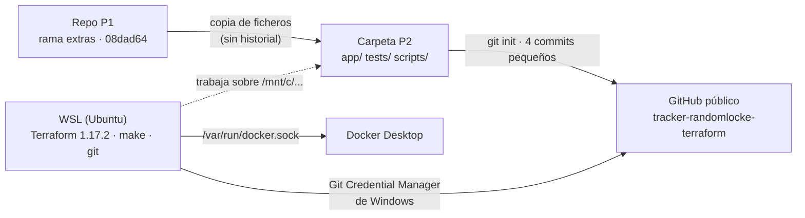

# Fase 0 · Preparación (17 y 18 nov. 2026)

## Dónde estamos

Fase 0 cerrada. Ya tenemos las herramientas comprobadas, el código de partida en un repositorio público nuevo y las decisiones de arquitectura anotadas. Todavía no hay ni una línea de Terraform del proyecto: eso empieza en la fase 1.

## Mapa

## Qué hicimos y por qué

1. **Partir de un código cerrado (0.1).** Subimos los cambios de la rama `extras` de la P1 y copiamos su código a una carpeta nueva. Así sabemos exactamente de qué versión parte la P2.
2. **Terraform con Docker (0.2).** Terraform ya estaba instalado en WSL. Lo probamos con un `main.tf` desechable fuera del repositorio: `init` → `plan` (`1 to add`) → `apply` → `plan` («No changes») → `destroy`.
3. **Repositorio (0.3).** Primero el `.gitignore` y después `git init`. El orden importa porque un secreto que entra en un commit queda en el historial para siempre.
4. **Documentos (0.4).** Diario, hoja de ruta y conceptos al día. El README se deja para el final.
5. **Audio del profesor.** Lo transcribimos en local con faster-whisper y lo resumimos (`docs/referencia/`, sin publicar). De ahí salieron varias decisiones.

## Decisiones clave

| Decisión | Alternativa descartada | Motivo |
|---|---|---|
| Repositorio propio para la P2 | Monorepo con la P1 | El README debe ser la portada, los commits deben mostrar el progreso de esta práctica y la P1 entregada no se toca |
| Código de `extras` copiado, sin historial | Clonar la P1 y seguir desde `extras` | Historial limpio; el commit de importación cita `08dad64` para la trazabilidad |
| Terraform y Git desde WSL sobre `/mnt/c` | Windows nativo; proyecto dentro de `~` | Terraform ya estaba en WSL y un solo sitio sirve al editor, a Claude y a la terminal |
| Balanceador Nginx en contenedor | Docker Swarm | Lo pide el profesor; además permite elegir la política y hacer healthchecks |
| Exposición mínima: solo Nginx publica puertos | Publicar MinIO y las consolas | Menos superficie de ataque y, en una nube, menos coste |
| Alertas de prod a Telegram | Solo verlas en Grafana; correo | Aviso real al móvil, visible en la demo, sin servidor de correo |
| Secretos en `secrets.auto.tfvars` (ignorado) | Variables `TF_VAR_...` | Se carga solo y no se olvida en la demo |
| Mismo código para dev y prod; solo cambia el `tfvars` | Imágenes distintas | En la P1, prod se quedó desactualizado; aquí no puede pasar |
| README al final (7.1) | Un esqueleto ahora | Escribirlo cuando sea cierto; mientras, el diario guarda las pruebas |

## Qué demostramos y cómo

- **Terraform controla Docker:** el segundo `plan` dijo «No changes» (idempotencia) y `docker images` mostró la imagen creada por `apply`.
- **El `.gitignore` protege los secretos:** con `git check-ignore` sobre 17 rutas de prueba, se ignoran el estado, los planes, `secrets.auto.tfvars`, `.terraform/` y el material local; se suben el lock, los `tfvars` y las plantillas.
- **La P2 es `extras`:** `diff -rq` de `app/` y `tests/` contra la P1 no dio ninguna diferencia.
- **El repositorio público no tiene material local:** ni `CLAUDE.md` ni `docs/referencia/`.

## Tropiezos

- Terraform «no estaba instalado»: lo busqué desde Windows y estaba en WSL, que tiene otro PATH.
- `tf-prueba` ejecutado como comando y `goit` en lugar de `git`: errores de tecleo con mensajes claros.
- La transcripción falló por una incompatibilidad de PyAV con faster-whisper; se resolvió decodificando el audio a mano.
- `git push` pidió usuario y contraseña: GitHub exige un token. Se resolvió usando el Git Credential Manager de Windows desde WSL.
- Confusión entre las ramas de la P1 y el repositorio de la P2: la P2 no hereda ramas, es una copia de `extras`.
- Al revisar el autor de los commits se mostró por error parte del correo en la conversación. No llegó al repositorio, y se decidió mantener el correo de la UIB como autor.

## Preguntas de defensa

- **¿Por qué el `.gitignore` antes del primer commit?** Porque ignorar algo después no lo saca del historial; un `tfstate` subido expondría contraseñas para siempre.
- **¿Qué significa que el segundo `plan` diga «No changes»?** Que el código, el estado y la realidad coinciden: Terraform es declarativo e idempotente.
- **¿Por qué `.terraform.lock.hcl` sí va a Git y `.terraform/` no?** El lock fija versiones y hashes del provider (reproducibilidad); `.terraform/` son binarios que `init` vuelve a descargar.
- **¿Por qué un repositorio nuevo y no seguir en el de la P1?** Para que la portada y el historial sean de esta práctica y la P1 entregada quede intacta.
- **¿Cómo te autenticas en GitHub si no acepta tu contraseña?** Con un token OAuth que guarda cifrado el Git Credential Manager de Windows.

## Qué viene ahora

**Fase 1 · Terraform mínimo en dev (18 y 19 nov.).** Paso 1.1: estructura `terraform/modules` y `terraform/envs/dev`, provider de Docker y `terraform init` en el proyecto real. Después vienen la red, el volumen y PostgreSQL con credenciales `sensitive`, y la primera web. La puerta de salida de la fase: dev funcionando con una web gracias a `terraform apply`.
