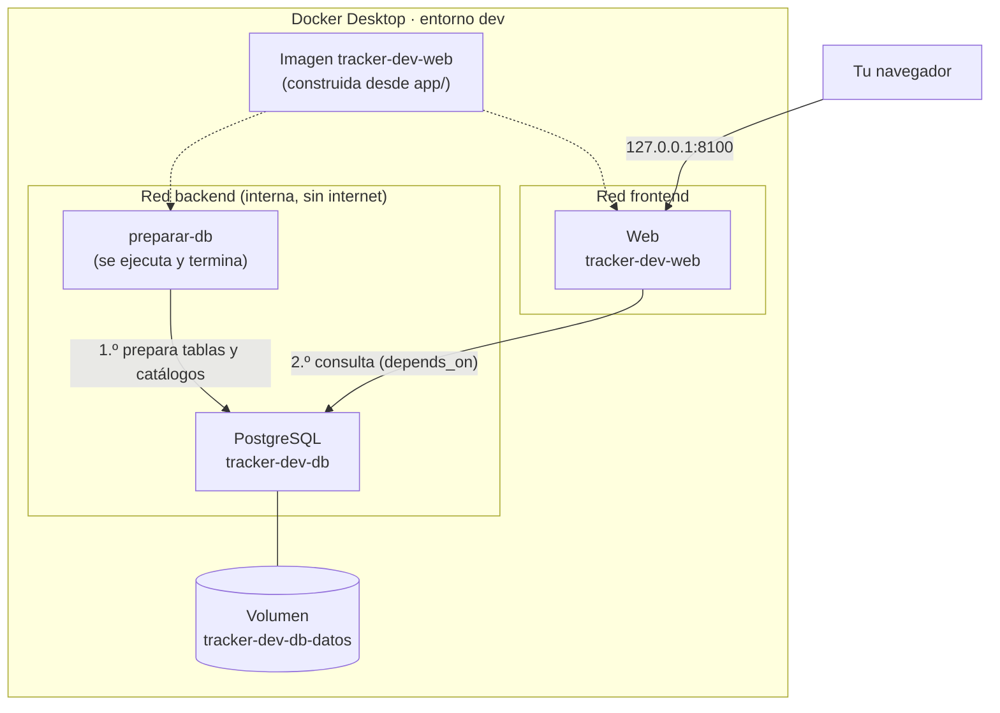

# Fase 1 · Terraform mínimo en dev (18 y 19 nov. 2026)

## Dónde estamos

Fase 1 cerrada. El entorno **dev** funciona entero con Terraform: una web conectada a PostgreSQL, en dos redes separadas, con los datos en un volumen y los secretos fuera de Git. Se crea con `terraform apply` (8 recursos, 19 s) y se borra con `terraform destroy` (7,8 s). Todo el código está todavía en `terraform/envs/dev/`; en la fase 2 se reorganiza en módulos y nace prod.

## Mapa

## Qué hicimos y por qué

| Paso | Qué | Por qué |
|---|---|---|
| **1.1** | `versions.tf` (Terraform `>= 1.6, < 2.0`, provider `kreuzwerker/docker ~> 3.9`), `providers.tf` (socket de Docker en WSL) y `terraform init` | Que Terraform sepa hablar con Docker, con versiones fijas para que sea reproducible |
| **1.2** | Variable `entorno` (validada a `dev`/`prod`), `terraform.tfvars`, `local.prefijo`, redes `frontend` y `backend` (interna) y el volumen | El mismo código servirá para prod; nombres `tracker-<entorno>-*` para no chocar con la P1; segmentación de red como en el prod de la P1 |
| **1.3** | Variables `sensitive`, `secrets.auto.tfvars` (fuera de Git) y su `.example`; PostgreSQL con healthcheck, reinicio, volumen, solo en `backend` y sin puertos | Credenciales fuera del código y de la pantalla; la base de datos inalcanzable desde fuera |
| **1.4.1** | `docker_image.web` construida desde `app/`, con una huella del código en `triggers` | Terraform no ve los cambios del código por sí solo; con la huella, el `plan` los detecta |
| **1.4.2** | `docker_container.web` en las dos redes, publicada solo en `127.0.0.1:8100`, con healthcheck sobre `/status` | Poner la web en marcha y conectada, con una ventanilla solo para este ordenador |
| **1.4.3** | Primer cambio en la app (`INICIALIZAR_DB`, `preparar_db.py`) y un contenedor de un solo uso que prepara la base de datos antes de la web | Separar responsabilidades: en la fase 3, varias webs arrancarán a la vez sin pisarse |
| **1.4.4** | Pruebas: recrear la web, tests de la API y destruir y crear desde cero | Demostrar que funciona, que los datos persisten y que es reproducible |

## Decisiones clave

| Decisión | Alternativa descartada | Motivo |
|---|---|---|
| Una carpeta raíz por entorno (`envs/dev`) | Workspaces | Estados separados: un `destroy` en dev no puede tocar prod |
| Prefijo `tracker-<entorno>` | `randomlocke-dev2` | Los filtros de Docker buscan por trozos y tocarían la P1; un volumen con el mismo nombre se reutilizaría sin avisar |
| `frontend` + `backend` con `internal = true` | Una sola red | Nginx no verá la base de datos, y la base de datos no tiene internet |
| Secretos en `secrets.auto.tfvars` y variables `sensitive` | Variables `TF_VAR_...` | Se cargan solas y no se olvidan en la demo |
| Huella del código en `triggers` | `-replace` a mano; `docker build` fuera de Terraform | El `plan` dice la verdad cuando cambia el código |
| `builder = "default"` y `dockerfile` con ruta completa | Constructor antiguo (por defecto) | Con *containerd*, el constructor antiguo se bloqueaba |
| Puerto publicado en `127.0.0.1` | `0.0.0.0` | Exposición mínima: nadie de la misma wifi puede entrar |
| `preparar-db` de un solo uso + `depends_on` | Que cada web prepare la base de datos | Con varias réplicas chocarían; la preparación es idempotente y solo se repite si cambia la imagen |
| `keep_locally` solo en `postgres:16` | Borrar todas las imágenes al destruir | La imagen de PostgreSQL la comparte la P1; la de la web es nuestra |

## Qué demostramos y cómo

- **Idempotencia:** después de cada `apply`, el segundo `plan` dice «No changes».
- **Secretos protegidos:** el `plan` muestra `(sensitive value)`; `git ls-files` solo contiene la plantilla `.example`; el estado está ignorado.
- **Aislamiento:** PostgreSQL solo está en `backend` y sin puertos publicados (`5432/tcp`); la web está en las dos redes con `127.0.0.1:8100->8000/tcp`.
- **Orden y preparación única:** `preparar-db` terminó `Exited (0)` en unos 2,2 s, antes de la web; el `lifespan` de la web tardó menos de 1 ms (`INICIALIZAR_DB=false`).
- **Persistencia:** con `terraform apply -replace=docker_container.web`, la partida de prueba siguió ahí y `preparar-db` no se repitió.
- **Funcionalidad:** `51 passed` en los tests de la API (50 funciones, una parametrizada).
- **Reproducibilidad:** `destroy` (8 recursos, 7,8 s) y `apply` (8 recursos, 19,2 s) desde cero, y otra vez `51 passed`.

## Tropiezos

- **Construcción bloqueada:** más de 5 minutos en «0/0 pasos». Con `docker buildx history` y el esquema del provider se vio que el constructor antiguo no funciona con el almacén *containerd*: `builder = "default"`. Después, `buildx` no encontraba el Dockerfile: `dockerfile` con ruta completa.
- **`Variables not allowed`:** los valores de `secrets.auto.tfvars` iban sin comillas. Se diagnosticó con un script que solo dice si cada valor va entre comillas, sin leerlo.
- **Comandos desde la carpeta equivocada:** `terraform` desde la raíz (`No configuration files`) y `git` desde `envs/dev` (`pathspec ... did not match`). El Makefile de la fase 2 lo resolverá.
- **Saltos de línea CRLF** en el diario al escribirlo desde PowerShell; se corrigió a LF.

## Preguntas de defensa

- **¿Por qué el segundo `plan` dice «No changes»?** Porque el código, el estado y lo que hay en Docker coinciden: Terraform es declarativo e idempotente.
- **Si cambias una línea de `app/main.py`, ¿qué dirá el `plan`?** Que se reemplazan la imagen (cambia la huella de `triggers`), `preparar_db` y la web (cambia su `image`): `-/+`, contados como destruir y crear.
- **¿Por qué la web necesita `depends_on` y PostgreSQL no?** La web no usa ningún dato de `preparar_db`, así que el orden hay que declararlo; en cambio, `DB_HOST=${docker_container.db.name}` ya crea una dependencia implícita.
- **Si `sensitive` oculta la contraseña, ¿por qué el estado no puede ir a Git?** Porque el estado guarda todos los atributos en texto plano, el `env` del contenedor incluido.
- **¿Puede Nginx (fase 3) conectarse a PostgreSQL?** No: Nginx solo estará en `frontend`, y PostgreSQL solo en `backend`.
- **¿Qué significa `5432/tcp` frente a `127.0.0.1:8100->8000/tcp`?** El primero es un puerto solo expuesto dentro de su red; el segundo, publicado en este ordenador.
- **¿Se pierden los datos al recrear la web? ¿Y con `destroy`?** Al recrear la web, no, porque viven en el volumen; con `destroy`, sí, porque el volumen también es un recurso de Terraform.

## Qué viene ahora

**Fase 2 · Módulos y entornos (20 y 21 nov.):**
- 2.1: pasar la red, la base de datos y la web a módulos reutilizables en `terraform/modules/`.
- 2.2: crear `envs/prod` con su `terraform.tfvars` (puerto 8200, `ENABLE_DOCS` apagado), con los dos entornos a la vez.
- 2.3: la caché Redis solo en prod.
- 2.4: el Makefile (`init`, `plan`, `apply` y `destroy` por entorno, desde la raíz).
