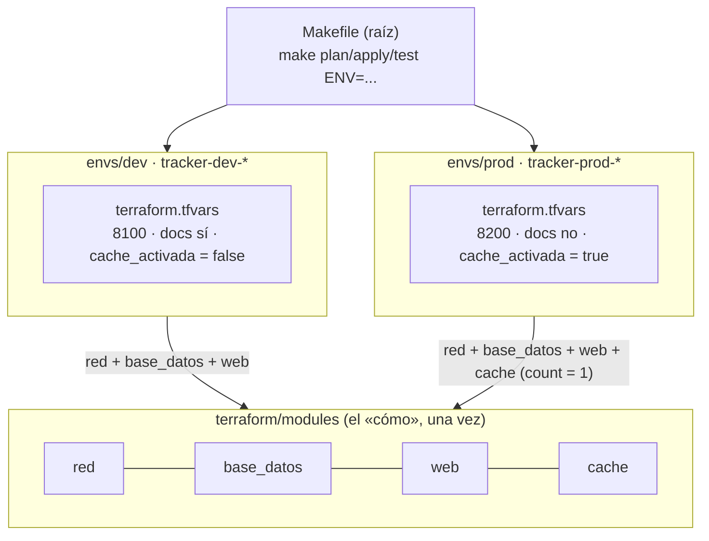

# Fase 2 · Módulos y entornos (20 nov. 2026)

## Dónde estamos

Fase 2 cerrada, un día antes de lo previsto. El código de Terraform está en **cuatro módulos reutilizables** y hay **dos entornos**, dev y prod, levantados a la vez con el mismo código y distintos valores. Prod tiene caché Redis y dev no. Todo se maneja desde la raíz con `make <comando> ENV=dev|prod`. Sigue habiendo una web por entorno: las réplicas y el balanceador llegan en la fase 3.

## Mapa

## Qué hicimos y por qué

| Paso | Qué | Por qué |
|---|---|---|
| **2.1** | Módulos `red`, `base_datos` y `web` (entradas en `variables.tf`, recursos en `main.tf`, salidas en `outputs.tf`); `envs/dev/main.tf` pasa de 141 a 32 líneas; bloques `moved` para la migración, retirados después | No duplicar código (lo que desincronizó el prod de la P1) y reorganizarlo **sin destruir nada** |
| **2.2** | `docs_activadas` como variable; `envs/prod` con los mismos `.tf`, sus valores y credenciales propias; los dos entornos a la vez | Lo exige el enunciado; mismo código y otros valores |
| **2.3** | Módulo `cache` (Redis con contraseña, sin persistencia, solo en `backend`), activado con `count` solo en prod; la web solo recibe las variables de caché si está activada | Caché en prod sin tocar dev: el código está en los dos, pero apagado en dev |
| **2.4** | `Makefile` con `init`, `fmt`, `validate`, `plan` (guarda el plan), `apply` (aplica el plan exacto), `destroy`, `output`, `ps` y `test` | Lanzar todo desde la raíz sin errores de carpeta; lo pide el enunciado |

## Decisiones clave

| Decisión | Alternativa descartada | Motivo |
|---|---|---|
| Un módulo por componente (`red`, `base_datos`, `web`, `cache`) | Un módulo gigante, o copiar `envs/dev` | Reutilizar por piezas sin duplicar |
| Bloques `moved` para pasar a módulos | Dejar que Terraform destruya y cree; `terraform state mv` | Sin cortes ni pérdida del volumen; queda en el código y se ve en el `plan` |
| `moved.tf` retirado tras migrar | Dejarlo | Ya no hacía falta y dev y prod quedan simétricos; queda en el historial |
| `ruta_app` como entrada del módulo `web` | Calcularla dentro | No atar el módulo a la estructura de carpetas |
| Mismos `.tf` en dev y prod; solo cambian `terraform.tfvars` y los secretos | Código distinto por entorno | El `tfvars` es la única diferencia y se lee de un vistazo |
| Credenciales de prod distintas (también el usuario) | Reutilizar las de dev | Si se filtran las de dev, no sirven para prod |
| Caché como módulo con `count` | Redis dentro de `web`; código suelto en prod | Es una pieza propia y compartida por todas las réplicas; activable en dev para probar |
| `env` de la caché condicional (`concat(..., cond ? [...] : [])`) | Enviar siempre `CACHE_ENABLED=false` | No recrear la web de dev |
| `plan -out` + `apply plan.tfplan` en el Makefile | `apply` interactivo | Se aplica exactamente lo revisado; el plan (con secretos) se borra |

## Qué demostramos y cómo

- **Refactor sin destruir:** el `plan` de la migración dio los 8 recursos con «has moved to» y `0 to add, 0 to change, 0 to destroy`; los contenedores conservaron su hora de arranque y siguieron `51 passed`.
- **Dos entornos que conviven:** puertos 8100 y 8200, redes, volúmenes y estados separados; `/docs` 200 en dev y 404 en prod; desde la web de dev, `tracker-prod-db` da `gaierror` (no se resuelve).
- **Independencia:** `terraform destroy` en prod borró solo sus recursos, mientras dev seguía «Up 3 hours».
- **Caché solo en prod:** `X-Cache` `MISS` → `HIT` (18,6 ms frente a 1,3 ms), «Caché: conectada» y `redis-cli ping` sin contraseña con `NOAUTH`; en dev, `X-Cache: OFF` y su `plan` en «No changes».
- **Makefile:** `validate`, `plan`, `apply`, `output`, `ps` y `test` desde la raíz; `ENV=produccion` se rechaza antes de tocar nada.
- **Tests:** `51 passed` en dev y en prod después de cada paso.

## Tropiezos

- **Variables declaradas a medias:** «Reference to undeclared input variable». Una variable que viaja al módulo necesita declararse en el entorno **y** en el módulo.
- **Ficheros sin guardar:** el módulo `cache`, una variable de dev y el Makefile (0 bytes, «No targets»).
- **Falta de `builder = "default"` al copiar al módulo `web`:** sin ella, la construcción se habría bloqueado y el `plan` habría recreado la web.
- **Comandos en la carpeta equivocada:** un `mkdir` lanzado desde `envs/prod` creó `envs/prod/terraform/modules/cache`, que se borró con `rmdir`. El Makefile lo evita a partir de ahora.

## Preguntas de defensa

- **¿Por qué módulos?** Para escribir cada componente una vez; dev y prod solo cambian sus valores en `terraform.tfvars`.
- **¿Qué pasaría si refactorizas a módulos sin `moved`?** `8 to add, 8 to destroy`: se recrearía todo y se perdería el volumen con los datos.
- **¿Cómo existe Redis en prod y no en dev con el mismo código?** `module "cache" { count = var.cache_activada ? 1 : 0 }`; prod pone `true` y dev `false`.
- **¿Por qué `module.cache[0]` y no `module.cache`?** Con `count`, el módulo es una lista: `[0]` es el primero y, en dev, no existe (por eso va con una condición).
- **¿Cómo demuestras que los entornos están aislados?** Redes distintas (dev no resuelve `tracker-prod-db`) y estados distintos (destruir prod no toca dev).
- **¿Por qué `make apply` no pide `yes` y `make destroy` sí?** `apply` aplica un plan ya revisado en `make plan`; `destroy` es irreversible.

## Qué viene ahora

**Fase 3 · Balanceador (21–22 nov.):** varias webs (2 en dev y 3 en prod) con `count` en el módulo `web`, mostrar en la página qué instancia responde (segundo cambio en la app), un módulo `balanceador` con Nginx y su política de reparto, alta disponibilidad (tumbar una web y que Nginx deje de enviarle tráfico) y la caché compartida entre réplicas.
