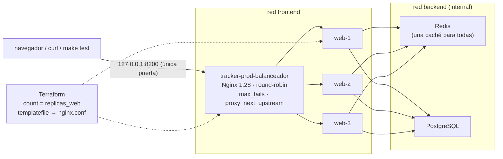

# Fase 3 · Balanceador (21 nov. 2026)

## Dónde estamos

Fase 3 cerrada, un día antes de lo previsto (estaba para el 22 y el 23). Cada entorno tiene **varias réplicas de la web** (2 en dev y 3 en prod) detrás de **un Nginx**, que es la única puerta de entrada (`127.0.0.1:8100` y `127.0.0.1:8200`), reparte por turnos y deja de enviar tráfico a una web caída sin que el usuario lo note. En prod, las tres réplicas comparten el mismo Redis, y la aplicación aguanta la caída de Redis sin perder velocidad en las escrituras.

## Mapa

## Qué hicimos y por qué

| Paso | Qué | Por qué |
|---|---|---|
| **3.0** | CSV a `app/datos/` y `schema.sql` a `app/db/` | Ordenar la app antes de tocarla |
| **3.1** | La app dice qué instancia responde (`INSTANCIA`, `/status`, cabecera `X-Instancia`, etiqueta en la página) y `count` en el módulo `web` (`replicas_web`: 2 en dev, 3 en prod) | Sin «placa», todas las réplicas responden igual y no se puede demostrar el reparto |
| **3.2** | Decisión (Nginx + round-robin); módulo `balanceador` con el `nginx.conf` generado por `templatefile` y metido con `upload`; las webs dejan de publicar puerto y solo publica Nginx; `make test` pasa por Nginx | Una sola puerta (exposición mínima) y una configuración que cambia sola al cambiar el número de réplicas |
| **3.3** | Conmutación por error (`max_fails=2 fail_timeout=10s`, `proxy_next_upstream error timeout http_502 http_504`, `proxy_connect_timeout 2s`); objetivos `logs`, `stop-web` y `start-web` | Que tumbar una web no se note para el usuario |
| **3.4** | Prueba de caché compartida e invalidación; objetivos `stop-cache` y `start-cache`; prueba con Redis caído; corrección de `invalidar_equipo` (tercer cambio en la app) | Comprobar que la caché sirve con varias réplicas y que Redis es una mejora, no una dependencia |

## Decisiones clave

| Decisión | Alternativa descartada | Motivo |
|---|---|---|
| Nginx como balanceador | HAProxy, Traefik | Una pieza para repartir y, en la fase 4, servir `/sprites/` desde MinIO; HAProxy no sirve ficheros; Traefik necesita el socket de Docker (equivale a *root*) |
| Round-robin | least_conn, ip_hash, weight | Peticiones cortas y parecidas, réplicas idénticas, app sin estado y reparto visible en la demo |
| `count` para las réplicas | `for_each` | Copias idénticas: solo cambia cuántas hay |
| `nginx.conf` generado por Terraform (`templatefile` + `upload`) | Escrito a mano o montado con un volumen | Se mantiene sincronizado con `replicas_web` y queda dentro del estado |
| `resolve` + `resolver 127.0.0.11` | Recrear Nginx cada vez que cambian las webs | Nginx encuentra las webs recreadas aunque cambien de IP (comprobado en el 3.4.3) |
| No reintentar con `503` | Reintentar con cualquier error | El 503 es la respuesta de la app cuando falla la BD; reintentar marcaría las tres webs como caídas y la página dejaría de decir «BD caída» |
| Healthcheck propio de Nginx (`/nginx-salud`) | Usar `/status` | No mezclar la salud de Nginx con la de las webs |
| `client_max_body_size 6m` | Límite por defecto (1 MB) | La app acepta guardados de hasta 5 MB; si no, Nginx daría 413 antes de llegar a ella |
| Redis común a todas las réplicas | Caché en memoria de cada web | Lo que guarda una web vale para todas y la invalidación también |
| No invalidar si la caché está marcada como caída | Intentarlo siempre | Cada intento costaba ~1,7 s; Redis vuelve vacío, así que no hay nada viejo que borrar |

## Qué demostramos y cómo

- **Réplicas con su placa:** cada réplica respondía con su nombre (`tracker-prod-web-1`, `-2`, `-3`), primero por su puerto temporal y después a través de Nginx.
- **Reparto:** `curl -sI http://127.0.0.1:8200/status` en bucle da `web-3, web-1, web-2, web-3…`; en el navegador, la etiqueta «Instancia: …» cambia sola.
- **Una sola puerta:** en `make ps`, solo el balanceador tiene `127.0.0.1:8200->80/tcp`; las webs, `8000/tcp`. El puerto antiguo de una réplica (8201) da `000`.
- **Alta disponibilidad:** con `make stop-web ENV=prod WEB=2`, 9 peticiones de 9 con `200`, solo `web-1` y `web-3`, y `51 passed`. El log de Nginx registra `tracker-prod-web-2 could not be resolved`. Con `make start-web`, `web-2` vuelve al turno sola.
- **Caché compartida:** `GET /runs/<id>/team` da `MISS` en `web-1` (12,2 ms) y `HIT` en `web-2` y `web-3` (~1 ms). Tras una captura registrada en `web-1`, la siguiente lectura es `MISS` en `web-2` con el equipo ya actualizado.
- **Redis caído:** todas las respuestas `200` con `X-Cache: DEGRADED` y `"cache":"caida"`; la primera lectura de cada réplica tarda ~1,7-2,6 s (en la P1, ~8 s) y después ~25 ms. Tras la corrección, las escrituras bajan de ~1,7 s a ~0,015 s y los tests sin Redis, de 207 s a 4,9 s.
- **Tests:** `51 passed` en dev y prod después de cada paso, desde el 3.2.3 a través de Nginx; `plan` final «No changes» en los dos entornos.

## Tropiezos

- **La cabecera `X-Instancia` dentro del `if` del middleware** (8 espacios en vez de 4): solo salía con HTML, JS y CSS. Se detectó en la revisión, porque `/status` y `/moves` no la llevaban.
- **Las escrituras lentas con Redis caído:** los tests sin Redis tardaron 207 s. Medir una escritura aislada (1,7 s frente a 0,02 s) llevó a la causa: `invalidar_equipo` no miraba si la caché estaba marcada como caída. Se corrigió en el 3.4.3.

## Preguntas de defensa

- **¿Cómo demuestras que Nginx reparte?** Con la cabecera `X-Instancia`, que pone cada réplica: en bucle con `curl` va rotando, y en la página la etiqueta cambia sola.
- **¿Por qué Nginx y no HAProxy o Traefik?** Nginx reparte y también servirá los estáticos desde MinIO. HAProxy no sirve ficheros (harían falta dos piezas) y Traefik necesita el socket de Docker, que equivale a ser *root*.
- **¿Por qué round-robin y no `ip_hash`?** La app no guarda sesiones en memoria (todo está en PostgreSQL o Redis), así que cualquier réplica puede atender a cualquiera; con `ip_hash`, además, las pruebas desde un mismo ordenador irían siempre a la misma web.
- **Si en prod pones `replicas_web = 4`, ¿qué hace el `plan`?** Crea `web[3]` (`tracker-prod-web-4`, sin puerto publicado) y reemplaza Nginx, porque su configuración generada gana una línea `server` y cambiar el contenido de `upload` obliga a recrear el contenedor. Las otras tres webs no se tocan.
- **Si tumbas una web, ¿cuántas peticiones fallan?** Ninguna en las pruebas: Docker la quita de su DNS y Nginx (`resolve`) la saca del turno; si le hubiera tocado antes, `proxy_next_upstream` habría reintentado en otra web.
- **Si paras las tres webs, ¿qué responde Nginx?** Su propio `502 Bad Gateway`, porque no le queda ninguna web viva. No es el 503 de la app: ese lo genera la app cuando falla la BD, y no hay ninguna app funcionando para generarlo.
- **¿Por qué las webs siguen en la red `frontend` si ya no publican puerto?** Porque Nginx solo está en `frontend`: es la red por la que les llega el tráfico. Publicar puerto (entrar desde el ordenador) y estar en una red (hablar con otros contenedores) son cosas distintas.
- **¿Por qué una sola caché para todas las réplicas?** Si cada web tuviera la suya, al cambiar un dato solo se invalidaría en una y las otras servirían el dato viejo.
- **¿Qué pasa si se cae Redis?** La web sigue sirviendo desde PostgreSQL (`X-Cache: DEGRADED`, «Caché: caída»), más lenta solo en la primera lectura de cada réplica (~2 s); los tests pasan igual.

## Qué viene ahora

**Fase 4 · MinIO (24 nov.):** un MinIO por entorno, en la red interna y sin publicar puertos, con los ~2050 sprites subidos una sola vez por un script de inicialización; Nginx servirá `/sprites/...` desde MinIO. Antes de empezar, comprobar qué imagen y versión de MinIO usar (fijando la etiqueta), porque en 2025 cambió la distribución de su edición gratuita.
