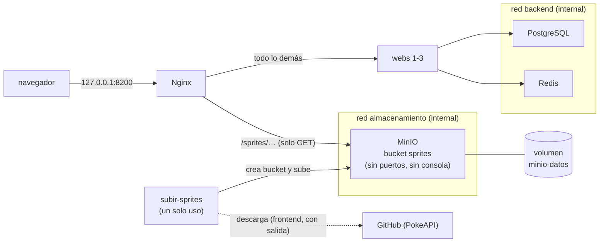

# Fase 4 · MinIO (24 nov. 2026)

## Dónde estamos

Fase 4 cerrada el día previsto. Cada entorno tiene **su propio MinIO** (almacenamiento de objetos compatible con S3), en una **red interna nueva** y sin puertos. Un **script de inicialización** crea el bucket `sprites` con lectura pública de sus objetos y sube los 2050 dibujos una sola vez. **Nginx** sirve `/sprites/...` desde MinIO, solo para leer. La app no se ha tocado: el navegador ya pedía esa ruta, que antes daba 404.

## Mapa

Nginx está en `frontend` y en `almacenamiento`, pero no en `backend`: ve a MinIO, no a la base de datos.

## Qué hicimos y por qué

| Paso | Qué | Por qué |
|---|---|---|
| **4.1.1** | Imagen `cgr.dev/chainguard/minio`, fijada por su huella `@sha256:` y con `keep_locally` | La imagen oficial de MinIO ya no existe (Docker Hub da 404; Quay tampoco la tiene) |
| **4.1.2** | Módulo `storage`: MinIO con volumen, credenciales `sensitive` (contraseña validada, ≥ 8), `MINIO_BROWSER=off`, sin puertos; red `almacenamiento` interna en el módulo `red` | Un MinIO por entorno (lo dijo el profesor), exposición mínima y sin mezclar con `backend` |
| **4.1.3** | `scripts/sprites/` (script con `boto3` y Pillow, su `Dockerfile`) y contenedor de un solo uso `subir-sprites` con `postcondition`; `descargar_sprites.py` de la P1 borrado (sigue en Git) | El enunciado pide scripts de inicialización; mismo patrón que `preparar_db` |
| **4.2.1** | Nginx entra en `almacenamiento`; `upstream minio` con `resolve` y `location /sprites/` con `limit_except GET` | Una regla más concreta que `/` manda los dibujos a MinIO; la app no cambia |
| **4.2.2** | Pruebas de lectura, escritura y listado | Demostrar las dos capas de solo lectura |

## Decisiones clave

| Decisión | Alternativa descartada | Motivo |
|---|---|---|
| MinIO de Chainguard | `bitnamilegacy/minio`, `pgsty/minio`, Garage / SeaweedFS / RustFS, volumen compartido | Es MinIO (el enunciado lo prefiere), mantenido y de una empresa conocida; las otras están congeladas, son de terceros, no son MinIO o no simulan S3 |
| Imagen fijada por `@sha256:` | Etiqueta `latest` | `latest` cambia y podría desaparecer; la huella garantiza la misma imagen en la demo |
| Volumen en `/home/nonroot` | Volumen en `/data`; ejecutar MinIO como *root*; un `chown` previo | Con `/data` falla (`file access denied`); `/home/nonroot` ya es del usuario 65532 y Docker copia ese dueño al volumen vacío; sin dar *root* ni añadir piezas |
| Red `almacenamiento` propia | MinIO en `backend` o en `frontend` | En `backend`, Nginx vería la BD; en `frontend`, MinIO tendría salida a internet |
| Sin consola de MinIO | Consola publicada | Exposición mínima; se podría activar solo en dev y en `127.0.0.1` si hiciera falta |
| Sin *healthcheck* en Docker para MinIO | Usar `curl` dentro | La imagen mínima no tiene `curl` ni *shell*; el script espera a `/minio/health/live` |
| `boto3` en el script | Cliente `mc` o SDK de MinIO | Es el cliente oficial de AWS: el mismo código serviría contra Amazon S3 |
| Lectura pública solo de objetos (`s3:GetObject`) | Bucket público completo | Se puede pedir un dibujo por su nombre, pero no listar, subir ni borrar |
| `limit_except GET` en Nginx | Confiar solo en la política de MinIO | Dos capas: Nginx corta antes de llegar a MinIO |

## Qué demostramos y cómo

- **La imagen elegida funciona:** con `/data`, `FATAL Unable to initialize backend: file access denied`; con `/home/nonroot`, arranca (`RELEASE.2026-11-23`) y `/minio/health/live` responde 200.
- **MinIO aislado:** sin puertos publicados; desde `frontend`, `tracker-prod-minio` no se resuelve (`gaierror`); la red `almacenamiento` es `internal=true`.
- **Inicialización idempotente:** primer `apply`, `subidos: 2050 · ya estaban: 0 · errores: 0` en cada entorno; al repetirse, `subidos: 0 · ya estaban: 2050`.
- **Dibujos por la única puerta:** `/sprites/25.png` y `/sprites/shiny/25.png` dan `200 image/png` en dev y prod, con `Server: nginx` (MinIO no se ve) y `Cache-Control: public, max-age=86400`; un dibujo inexistente, `404`.
- **Solo lectura en dos capas:** `PUT` y `DELETE`, `403` con la página HTML de Nginx; listar `/sprites/`, `403` con el XML `AccessDenied` de MinIO.
- **Nada roto:** `51 passed` en los dos entornos y `plan` «No changes».

## Tropiezos

- **La imagen oficial de MinIO ya no existía:** hubo que comprobar qué imágenes quedaban y elegir con criterio (subpaso 4.1.1).
- **Permisos del volumen:** la imagen sin *root* no podía escribir en un volumen nuevo montado en `/data`; se descubrió en una prueba aislada antes de escribir el módulo.
- **Nombres a medias al renombrar el módulo a `storage`:** el bloque `module` usaba `red_storage = module.red.storage`, que no existían. Cambiar el nombre de la carpeta no cambia las `variable` ni los `output` de dentro.

## Preguntas de defensa

- **¿Qué es MinIO y en qué se diferencia de un volumen y de PostgreSQL?** Un servidor que guarda ficheros enteros y los entrega por HTTP con la API de S3. Va encima de un volumen (su disco), como PostgreSQL; PostgreSQL guarda filas y responde a consultas SQL, MinIO guarda ficheros y los entrega por su nombre.
- **¿Por qué no usas la imagen `minio/minio`?** Ya no existe: MinIO dejó de publicar imágenes gratuitas (el código sigue siendo libre, AGPL). Uso la que compila Chainguard desde ese código, fijada por su huella.
- **¿Por qué el volumen está en `/home/nonroot`?** MinIO se ejecuta sin *root* (usuario 65532). Un volumen nuevo es de *root*; montado sobre una carpeta de la imagen que ya es de ese usuario, Docker le copia el dueño y MinIO puede escribir.
- **¿Por qué una red nueva para MinIO?** Nginx necesita llegar a MinIO; si MinIO estuviera en `backend`, Nginx tendría que entrar ahí y vería la base de datos.
- **¿Cómo llega un dibujo al navegador?** El navegador pide `/sprites/25.png` a Nginx; la regla `location /sprites/` (más concreta que `/`) lo pide a MinIO (`/sprites/25.png` del bucket) y devuelve la imagen. El resto de rutas siguen yendo a las webs.
- **¿Puede alguien subir o borrar dibujos?** No: Nginx solo deja pasar `GET` (`PUT` y `DELETE` dan 403 de Nginx) y, aunque llegaran, la política del bucket solo permite leer un objeto por su nombre (listar da 403 de MinIO).
- **¿Qué pasa si el script de los dibujos se ejecuta dos veces?** Nada: mira qué hay en el bucket y solo sube lo que falta (la segunda vez, `subidos: 0`).
- **¿Por qué `boto3`?** Es el cliente oficial de AWS; cambiando la dirección, el mismo script subiría los dibujos a Amazon S3. Eso es lo que significa que MinIO simula S3.

## Qué viene ahora

**Fase 5 · Monitorización, logs y alertas (25 y 26 nov.):** Prometheus y cAdvisor (estado, CPU y memoria de cada contenedor), Grafana con panel creado automáticamente, logs centralizados con Loki, y alertas a Telegram en prod. Con la seguridad ya apuntada: red interna `monitorizacion`, Grafana solo en `127.0.0.1` con contraseña `sensitive` y sin acceso anónimo, y salida a internet solo para Grafana.
