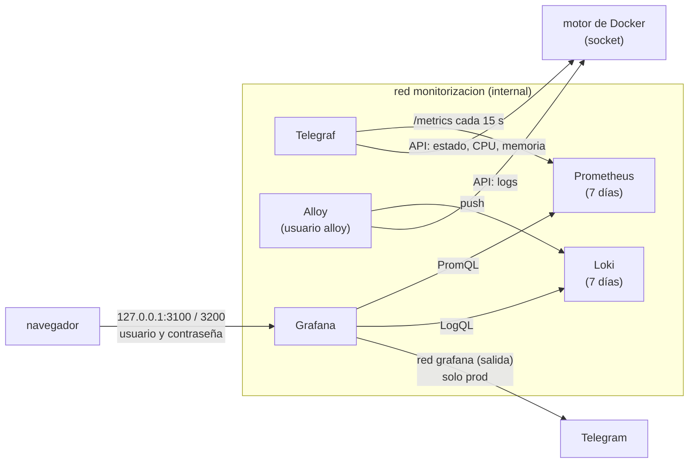

# Fase 5 · Monitorización, logs y alertas (24-27 nov. 2026)

## Dónde estamos

Fase 5 cerrada con un día de retraso sobre lo previsto (era para el 25-26 nov.). Cada entorno tiene **su propia monitorización** en una red interna nueva, `monitorizacion`:

- **Métricas:** Telegraf recoge el estado, la CPU y la memoria de cada contenedor y Prometheus guarda el historial.
- **Logs:** Alloy los recoge y Loki los guarda.
- **Grafana:** enseña métricas y logs en un panel y evalúa cuatro reglas de alerta.

Todo se crea desde el código (*provisioning*). En prod, Grafana además **avisa por Telegram**. Solo Grafana publica un puerto, y solo en `127.0.0.1` y con contraseña.

## Mapa

Ni Nginx ni las webs están en `monitorizacion`: si alguien se apoderara de una web, no llegaría a la monitorización ni al socket de Docker.

## Qué hicimos y por qué

| Paso | Qué | Por qué |
|---|---|---|
| **5.1.1** | Elegir herramientas: Prometheus + Grafana, Loki + Alloy, Grafana Alerting | Una pieza por trabajo; ligeras para dos entornos en un portátil; ELK pesa demasiado |
| **5.1.2** | Módulo `monitorizacion` con **Telegraf** (en lugar de cAdvisor) y Prometheus | cAdvisor no ve los contenedores con Docker Desktop + WSL; Telegraf pregunta a la API de Docker, que sí llega |
| **5.1.3** | Grafana: red propia, credenciales `sensitive`, solo en `127.0.0.1`, fuente de datos y panel «Contenedores» por *provisioning*, desplegable por contenedor | Ver estado, CPU y memoria sin configurar nada a mano y sin dejar Grafana abierto |
| **5.2.1** | Loki y Alloy (Alloy como usuario `alloy`, solo el socket); fuente Loki en Grafana | Logs de todos los contenedores del entorno en un sitio, con la etiqueta `container_name` (la misma que las métricas) |
| **5.2.2** | Paneles de logs en «Contenedores» y cuadro «Buscar en los logs» | Métricas y logs del mismo contenedor en una pantalla (opcional: Explore ya cumplía) |
| **5.3.1** | Cuatro reglas: web caída, servicio caído, CPU alta, errores 5xx (esta, desde los logs); `/metrics` de Grafana desactivado; `make web` y `make grafana` | Lo que pide el enunciado más los dos huecos más graves; cerrar la única parte de Grafana sin contraseña |
| **5.3.2** | Telegram solo en prod (`telegram_activado`), alertas con el nombre del contenedor, mensaje propio por secciones; `must_run = false` | Avisar sin abrir puertos; mensajes que dicen qué falla y dónde; que un `plan` no borre contenedores parados |

## Decisiones clave

| Decisión | Alternativa descartada | Motivo |
|---|---|---|
| Telegraf como recolector | cAdvisor (privilegiado, con `cgroupns=host`), Docker Engine en Ubuntu, trabajar desde Windows | Con Docker Desktop, Terraform pide desde Ubuntu y el motor vive en otra máquina: cAdvisor mira carpetas vacías. La API sí llega. En un servidor Linux real: cAdvisor + `node-exporter` |
| Loki + Alloy | ELK; Promtail; *driver* de Docker para Loki | Loki solo indexa etiquetas (~70 MiB frente a 1-2 GB); Promtail está retirado; el *driver* va fuera de Terraform |
| Panel, fuentes y alertas como código | Crearlos a mano en la web | Se recrean solos con el entorno y se pueden revisar en Git |
| Mismas reglas en dev y prod, Telegram solo en prod | Avisar desde los dos | Dev prueba las reglas sin generar avisos (fatiga de alertas) |
| Alertas por nombre (`label_replace` + `unless`) | Recuento (`count < N`) | El recuento no sabía qué web faltaba |
| Umbrales: 1 min (caída), 80 % de un núcleo durante 2 min (CPU), > 10 errores 5xx en 5 min | Avisar al instante; 50 % o 95 % de CPU | Sin falsas alarmas por reinicios o picos de arranque; la CPU de Telegraf es por núcleo |
| Tiempos de aviso: 2-4 min (resuelta, hasta ~5) | Acortar evaluación, `for` y `group_wait` | Decisión del usuario: valores defendibles; en la demo se lanza la caída al empezar a explicar |
| `must_run = false` | Valor por defecto (`true`) | Con `true`, el provider borra en el *refresh* de un `plan` los contenedores parados |

## Qué demostramos y cómo

- **Métricas por contenedor:** Prometheus solo guarda los contenedores del entorno; panel con 10 contenedores en dev y 12 en prod, CPU (por núcleo) y memoria.
- **Grafana cerrado:**
  - sin contraseña, con credenciales falsas o al registrarse, `401`;
  - `/metrics`: antes `200`, ahora redirige a `/login`;
  - solo en `127.0.0.1`.
- **Logs:** `{container_name="tracker-prod-balanceador"} |= "no-existe-prod"` devuelve la petición con su `404`; Loki tiene los logs de los 10 / 12 contenedores.
- **Aislamiento:** desde `frontend` o desde la monitorización de dev, `tracker-prod-loki` no se resuelve; Alloy se ejecuta como `uid=473(alloy)`.
- **Alertas:**
  - antes de aplicarlas, se probaron en un Grafana aislado («Web caída», «Servicio caído» y «Errores…» pasaron a *Alerting*);
  - después: 4 reglas activas en *Normal* en los dos entornos.
- **Telegram:** `make stop-web WEB=2 ENV=prod` → «tracker-prod-web-2 no está en marcha (de 3 webs)» y, al arrancarla, «✅ Resuelto».
- **Nada roto:** `51 passed` y `plan` «No changes» en los dos entornos.

## Tropiezos

- **cAdvisor no veía los contenedores:** el contenedor estaba `healthy`, pero no había datos. Lección: comprobar los **datos**, no solo que el contenedor esté sano. Una prueba con montajes recursivos de `/` y `/sys` rompió Docker Desktop y hubo que reiniciar WSL: no se repite.
- **Telegraf sin permiso para el socket:** se ejecuta sin *root*; se resolvió con `group_add` y el grupo del socket, que calcula el Makefile.
- **Un `plan` borró `web-2`:** estaba parada para la prueba y el provider borra en el *refresh* los contenedores parados con `must_run = true`. Se reprodujo aparte y se corrigió con `must_run = false`.
- **Token del bot filtrado en una captura:** se revocó en @BotFather y se usó uno nuevo. Una captura filtra igual que pegar el valor.
- **Mensajes poco claros:** el mensaje por defecto de Grafana y la regla de recuento no decían qué web había caído; se cambiaron a petición del usuario.

## Preguntas de defensa

- **¿Por qué Telegraf y no cAdvisor?** Por cómo se ejecuta Docker Desktop: Terraform pide desde Ubuntu, el motor vive en la máquina `docker-desktop` y cAdvisor recibe las carpetas de Ubuntu, sin contenedores. Telegraf pregunta a la API, como `docker stats`, y eso sí llega. En un servidor Linux usaría cAdvisor.
- **¿Qué hace cada pieza?** Telegraf recoge métricas y Prometheus va a pedírselas y las guarda; Alloy recoge logs y se los empuja a Loki, que los guarda; Grafana los consulta, los enseña y avisa.
- **¿Por qué Telegraf y Alloy pueden usar el socket de Docker y Traefik no?** Porque medir y leer logs es su trabajo; Traefik solo lo quería para enrutar, cosa que ya hace Terraform. Usar el socket equivale a tener el control de Docker, así que se limita: sin *root*, red interna, sin puertos, imágenes oficiales fijadas.
- **¿Cómo llega una alerta al móvil?** La regla detecta el fallo; la política decide a quién avisar y agrupa; el punto de contacto llama a la API de Telegram saliendo por la red `grafana`. No se abre ningún puerto.
- **¿Por qué dev no avisa por Telegram?** Porque se rompe a menudo por las pruebas y acabarías ignorando los avisos. Tiene las mismas reglas, pero `telegram_activado = false` y el bloque `dynamic` ni existe.
- **¿Por qué tarda 2-4 minutos el aviso?** Es la suma de esperas: recogida (~25 s), evaluación (30 s), `for` de 1 minuto y `group_wait` de 30 s. Esas esperas evitan las falsas alarmas.
- **Si pones `replicas_web = 4`, ¿qué pasa con las alertas?** Se recrea Grafana y la lista de webs esperadas pasa a tener cuatro, sin tocar la regla.
- **¿Puede un `terraform plan` cambiar algo?** Debería ser de solo lectura, pero el provider ejecuta código al leer el estado: con `must_run = true` borraba los contenedores parados.

## Qué viene ahora

**Fase 6 · Pruebas (27-28 nov.):**
- tests de la API a través del balanceador en los dos entornos;
- pruebas de la infraestructura con sus salidas para el README:
  - reparto entre réplicas;
  - caída de una web;
  - MinIO de solo lectura;
  - alerta en Telegram;
  - aislamiento entre redes y entornos;
- borrar con cuidado los volúmenes `prueba-*-p2` que dejó la prueba de cAdvisor.

**Fase 7 · Entrega (28-29 nov.):** README, `make demo`, prueba desde cero y guía de defensa.

Quedan como ideas para cuando se publique la web: la regla de «Reinicios» y el resto de «Más alertas» de la hoja de ruta.
